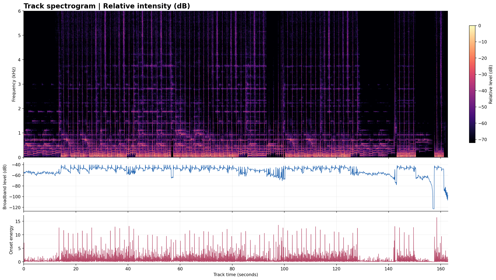
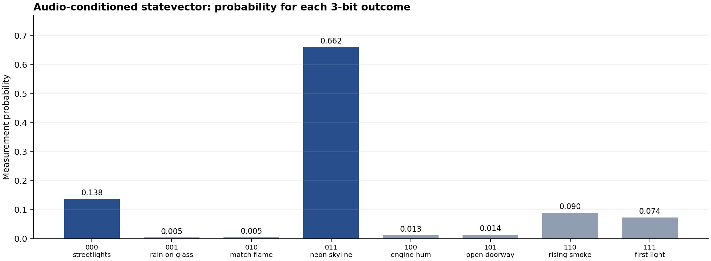
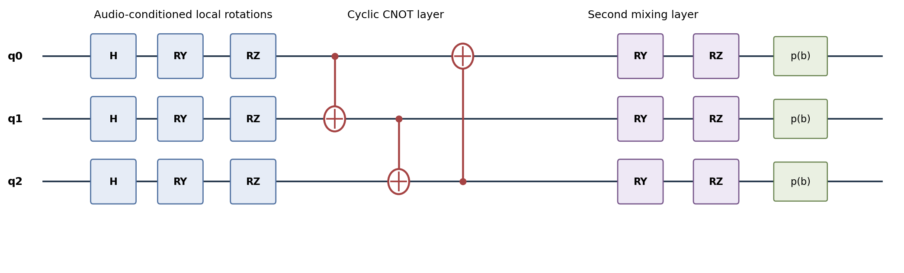

# From Waveform to Words: The Spectrogram → RGB-Band Energy → Three-Qubit Circuit → Entropy → Suno Songwriting Pipeline

**Complete technical README, operator manual, mathematical derivation, reproducibility guide, and annotated source reference**  
**Dataset:** `Punchier Pre-Chorus and Chorus (Extended) (1) (1) (1).wav` (losslessly stored as `original_audio_lossless.flac`)  
**Creative result:** *Bring on the Night*  
**Recorded analysis date:** 16 October 2026  
**Scope:** one supplied audio recording; one scripted analysis; one audio-conditioned, NumPy-simulated circuit; one human/AI-authored lyric treatment.

> **Read this before interpreting the paper:** No physical quantum computer was used. `quantum_rgb_entropy.py` implements an 8-dimensional state vector with ordinary NumPy matrices. Its 4,096 "shots" are seeded **pseudorandom samples** from an analytically calculated probability vector, not physical quantum measurements. The entropy value quantifies the uncertainty of those eight outcomes; it does **not**, by itself, quantify musical quality, semantic cohesion, originality, or a causal improvement in lyrics. The source code chooses *writing constraints*. The final lyrics were composed separately, using those constraints and the track analysis; there is no machine-learning lyric generator inside the Python script.

---

## Table of contents

1. [The one-minute explanation](#1-the-one-minute-explanation)
2. [Exact provenance: what ran and what did not](#2-exact-provenance-what-ran-and-what-did-not)
3. [What's in the ZIP?](#3-whats-in-the-zip)
4. [Quick start, including lossless WAV recovery](#4-quick-start-including-lossless-wav-recovery)
5. [The complete data-flow architecture](#5-the-complete-data-flow-architecture)
6. [Formal audio signal model](#6-formal-audio-signal-model)
7. [Resampling and windowing](#7-resampling-and-windowing)
8. [The short-time Fourier transform](#8-the-short-time-fourier-transform)
9. [Decibels, RMS, spectral centroid, and spectral flux](#9-decibels-rms-spectral-centroid-and-spectral-flux)
10. [Beat, tempo, bars, and alignment](#10-beat-tempo-bars-and-alignment)
11. [Pitch chroma and candidate key](#11-pitch-chroma-and-candidate-key)
12. [Energy-defined song sections](#12-energy-defined-song-sections)
13. [What "RGB" really means here](#13-what-rgb-really-means-here)
14. [Computing the actual three-band energy](#14-computing-the-actual-three-band-energy)
15. [Why and how the audio determines the random seed](#15-why-and-how-the-audio-determines-the-random-seed)
16. [From three band weights to three rotation angles](#16-from-three-band-weights-to-three-rotation-angles)
17. [Qubit mathematics and state-vector simulation](#17-qubit-mathematics-and-state-vector-simulation)
18. [Every gate, in the actual order](#18-every-gate-in-the-actual-order)
19. [CNOT wiring and bit conventions](#19-cnot-wiring-and-bit-conventions)
20. [Measurement probabilities: Born rule](#20-measurement-probabilities-born-rule)
21. [Shannon entropy: derivation and interpretation](#21-shannon-entropy-derivation-and-interpretation)
22. [The 4,096 simulated measurements](#22-the-4096-simulated-measurements)
23. [The motif and rhyme selection mechanism](#23-the-motif-and-rhyme-selection-mechanism)
24. [From constraints to narrative cohesion](#24-from-constraints-to-narrative-cohesion)
25. [Cadence math and prosody](#25-cadence-math-and-prosody)
26. [Full timeline and arrangement instructions](#26-full-timeline-and-arrangement-instructions)
27. [Suno workflow: which prompt goes in which field](#27-suno-workflow-which-prompt-goes-in-which-field)
28. [Prompt provenance and independently repeatable creative prompt](#28-prompt-provenance-and-independently-repeatable-creative-prompt)
29. [End-to-end reproducibility recipes](#29-end-to-end-reproducibility-recipes)
30. [Tests and expected results](#30-tests-and-expected-results)
31. [Parameter sensitivity and ablation experiments](#31-parameter-sensitivity-and-ablation-experiments)
32. [Scientific limitations, alternative interpretations, and failure modes](#32-scientific-limitations-alternative-interpretations-and-failure-modes)
33. [Frequently asked questions](#33-frequently-asked-questions)
34. [Reference equations and symbol glossary](#34-reference-equations-and-symbol-glossary)
35. [Appendices: complete, unmodified source code and saved outputs](#35-appendices-complete-unmodified-source-code-and-saved-outputs)

---

## 1. The one-minute explanation

Imagine you have a backing track but no finished top-line. Instead of generating random words and asking a singing synthesizer to make them fit, this experiment first **measured the backing track**. It read a 48 kHz stereo PCM WAV, converted the two channels to mono, generated a spectrogram, and estimated tempo, relative musical key, and broad structural changes. The resulting working pulse was approximately **133.93 BPM** in a hypothesized 4/4 meter. The leading key hypothesis was **D♯ minor / E♭ minor**, not a verified harmonic transcription.

A separate Python script summarized the audio's overall energy into three coarse frequency bands, whimsically labeled **R**, **G**, and **B**. Those labels stand for low, middle, and high *audio frequencies*, not red, green, and blue wavelengths. The band proportions became rotation angles in a custom three-qubit-style NumPy circuit. The circuit produced eight probabilities, one for each three-bit computational basis string from `000` to `111`. Their Shannon entropy was **1.622796 bits**.

The code drew 4,096 seeded samples from those eight probabilities, picked the most common two outcomes, and looked them up in a fixed array of lyrical images and rhyme sets. For this recording, the results were **neon skyline** + **streetlights**, with principal rhyme families **glow/slow/go** + **night/light/bright**. Those were *creative constraints*, not machine-generated finished lines.

Finally, the lyrics were drafted for a human-readable vocal arrangement: more syllables and short rhythmic attacks in the verses, wider spaces in the pre-choruses, longer held vowels in the choruses, and a restrained breakdown. The repeating hook became **“BRING ON THE NIGHT / I'VE GOT MY OWN LIGHT”**. Instructions and the style prompt were separated from the words intended to be sung in Suno.

**In one sentence:** spectrum → track timing and energy + RGB energy ratios → state-vector probabilities → entropy and seeded samples → constrained imagery/rhyme choices → human/AI lyric-writing and Suno placement.

## 2. Exact provenance: what ran and what did not

This archive is designed to distinguish original experimental records from explanations written later. That distinction matters whenever a technical workflow is presented as reproducible.

**Original code that actually ran:**

- `analyze_audio.py`: loads the supplied WAV, computes 12 kHz mono STFT and librosa features, saves `track_analysis.json` and `track_spectrogram.png`.
- `quantum_rgb_entropy.py`: computes the audio-derived RGB energy ratios and deterministic seed, simulates the three-qubit circuit with NumPy, samples 4,096 labels, picks imagery/rhymes, and saves `quantum_rgb_entropy_results.json`.
- Both analysis results were saved. The entropy calculation was subsequently rerun using the same source WAV, producing `quantum_rgb_entropy_recheck.json`, with byte-identical JSON content relative to the earlier result.

**Later packaging and documentation:**

- `create_figures.py` produces figures for the subsequent paper; it was not the original audio-analysis or motif-selection engine.
- `restore_wav.py` is a packaging convenience. It recreates a PCM WAV from a lossless FLAC in order to get the archive below 25 MB without destroying audio information.
- `verify_pipeline.py` is an *additional check in this expanded README edition*, not an original 2026-10-16 generation step.
- The PDF, DOCX, and research-paper Markdown explain the method after the experiment. They are reports, not a complete automatic lyric-generation program.
- The words, vocal arrangement, and Suno-facing prompts in `Bring_On_The_Night_Suno_Lyrics_and_Cadence.md` are creative outputs informed by the analyses.

**Not done:** no PennyLane import, no execution on IBM/other quantum hardware, no physically quantum true-random entropy source, no optimization/training loop, no acoustic source separation, no automatic transcription of a lead vocal, no automatic proof of a specific key, no verified downbeat annotation, and no Suno API run contained in this package. The exact internal intermediate natural-language drafting messages were not archived and should not be presented as an executable transcript of a hidden process.

## 3. What's in the ZIP?

| File | Purpose | When it was produced |
|---|---|---|
| `README.md` | This comprehensive operator's and theory manual | Expanded README edition |
| `README_REPRODUCE.md` | Short original reproducibility note | Earlier packaging |
| `Spectrogram_Quantum_RGB_Entropy_Research_Paper.pdf` | Formatted 21-page scientific-style report | Subsequent technical write-up |
| `Spectrogram_Quantum_RGB_Entropy_Research_Paper.docx` | Editable paper | Subsequent write-up |
| `Spectrogram_Quantum_RGB_Entropy_Research_Paper.md` | Source paper in Markdown | Subsequent write-up |
| `original_audio_lossless.flac` | Compressed **lossless** stereo audio, replacing 30 MB WAV | Under-25-MB package |
| `restore_wav.py` | Recovers a signed-16-bit PCM WAV from FLAC | Under-25-MB package |
| `analyze_audio.py` | **Original** spectrogram, beat, chroma, and dynamics code | Initial analysis |
| `quantum_rgb_entropy.py` | **Original** audio-conditioned NumPy circuit | Initial analysis |
| `track_analysis.json` | Numeric duration, RMS, chroma, sections, changes, and BPM | Initial analysis |
| `quantum_rgb_entropy_results.json` | RGB ratios, seed, probabilities, entropy, chosen images/rhymes | Initial circuit run |
| `quantum_rgb_entropy_recheck.json` | Rerun results for comparison | Later verification |
| `track_spectrogram.png` | The large original spectrogram and dynamics plot | Initial analysis |
| `measurement_probabilities.png` | Eight-outcome probability visualization | Paper preparation |
| `circuit_schematic.png` | Circuit gate/wire schematic | Paper preparation |
| `create_figures.py` | Code to rebuild the paper's additional plots | Paper preparation |
| `Bring_On_The_Night_Suno_Lyrics_and_Cadence.md` | Original complete lyric field, style field, time map, and performance guide | Initial lyric output |
| `requirements_verified.txt` | Versions recorded during research-paper verification | Paper preparation |
| `verify_pipeline.py` | Validates core math and rerun outputs | Expanded README edition |
| `MANIFEST_SHA256.json` | File digests to detect unexpected changes; regenerated for this edition | Packaging |

**Reading the visual results**







The three panels in the first figure should not be conflated. The first is time-frequency **magnitude** in relative decibels; the second is a framewise RMS-of-STFT-magnitudes **proxy**; the third is librosa's estimated **onset strength**. They are not three independent measurements of song quality.

## 4. Quick start, including lossless WAV recovery

This workflow is meant to be inspectable using a local Python environment. The archived code was verified with **Python 3**, NumPy **2.3.5**, SciPy **1.17.0**, librosa **0.11.0**, soundfile **0.13.1**, and Matplotlib **3.10.8**. These were the recorded versions, not a promise of identical execution on arbitrary software stacks. Recent versions generally work, but they may produce small differences in feature analysis and plotted pixels.

**A. Unzip, create an environment, and install packages:**

```bash
python -m venv .venv
# macOS or Linux:
source .venv/bin/activate
# Windows PowerShell (alternative): .venv\Scripts\Activate.ps1
python -m pip install -r requirements_verified.txt
```

**B. Restore the source recording in the current folder:**

```bash
python restore_wav.py
```

This creates `Punchier Pre-Chorus and Chorus (Extended) (1) (1) (1).wav`. It should be stereo, 48,000 samples/s, 16-bit PCM, and 162.8 seconds long. Lossless FLAC is a reversible representation of the source PCM samples. WAV file metadata or header byte layout may vary by tool, but the recovered PCM audio samples were checked during packaging.

**C. Recompute the quantum-inspired circuit and save a separate result file:**

```bash
python quantum_rgb_entropy.py \
  'Punchier Pre-Chorus and Chorus (Extended) (1) (1) (1).wav' \
  --json rerun_entropy.json
```

In Windows PowerShell, run the command on a single line rather than with the Unix `\` continuation. The output should show probabilities for `000` through `111`, an entropy around `1.622796`, and the same two imagery motifs.

**D. Run the new validation script:**

```bash
python verify_pipeline.py
```

It cross-checks the band ratios, probability normalization, gate unitarity, entropy, audio-conditioned seed, and selected motifs against the saved machine output. It does not claim to validate the subjective lyric quality.

**E. Open the spectrogram:** `track_spectrogram.png` is already included. You do not have to rerun the original plotting script to inspect the result.

**F. If you want to reproduce the original spectrogram script exactly:** it has **absolute `/mnt/data/` file paths**, assumes the original audio is **48 kHz**, and writes output to `/mnt/data/`. On Linux, place the unpacked WAV at precisely `/mnt/data/Punchier Pre-Chorus and Chorus (Extended) (1) (1) (1).wav`, then run:

```bash
python analyze_audio.py
```

Alternatively, edit only the source/input/output path literals in `analyze_audio.py` for your computer, and make an appropriate resampling change if your source is not 48 kHz. The unmodified original remains in the archive for evidence. Running it unchanged in an arbitrary directory will not work; the script was not built as a portable CLI.

**G. Read or use the lyrics:** open `Bring_On_The_Night_Suno_Lyrics_and_Cadence.md`. The **Style of Music** prompt and **Lyrics** field are deliberately separate.

## 5. The complete data-flow architecture

The original experiment has two analytical branches connected by the *same audio input*, followed by a creative-writing branch. It is not a single trainable model.

```text
                   ORIGINAL STEREO WAV (48 kHz, 16-bit PCM)
                                   |
                         downmix: left/right mean
                                   |
                   +---------------+----------------+
                   |                                |
          BRANCH A: STRUCTURE                 BRANCH B: PALETTE
                   |                                |
          downsample to 12 kHz               downsample to 12 kHz
                   |                                |
          2048-point STFT                     128 × 8192-pt FFT
                   |                                |
       spectrogram, RMS, flux                 three band-energy sums
                   |                                |
          onset, beats, chroma                 normalize (R,G,B)
                   |                                |
      tempo, key hypotheses,                 convert to gate angles
        energy-boundary clues                        |
                   |                        H, Ry, Rz, 3 CNOTs,
                   |                          second Ry/Rz layer
                   |                                |
                   |                        amplitudes → 8 probabilities
                   |                                |
                   |                        Shannon H(p); 4096 PRNG shots
                   |                                |
                   |                        top motifs + rhyme sets
                   |                                |
                   +---------------+----------------+
                                   |
                     EDITORIAL / CREATIVE COMPOSITION
                          narrative arc + motif limit
                        cadence + hook repeat discipline
                                   |
                          SUNO STYLE PROMPT
                          SUNO CUSTOM LYRICS
                          SUNG OR SYNTHESIZED VOCALS
```

This architecture separates **description** (audio features), **stochastic-looking selection** (sampled circuit outcomes), and **composition** (language, meaning, singing instructions). That separation protects against claiming that a frequency bin, a quantum gate, or a number of bits literally "contains" the words of the song.

## 6. Formal audio signal model

A digital stereo waveform is a discrete array of sample pairs. Write left and right channel samples as \(x_L[n]\) and \(x_R[n]\), where \(n=0,1,\ldots,N-1\), and the source sampling rate is \(f_s=48,000\,\mathrm{Hz}\). The total duration is:

$$
T=\frac{N}{f_s}=162.8\ \mathrm{seconds}.
$$

The first operation in both original scripts is a simple stereo downmix:

$$
x_M[n]=\frac{x_L[n]+x_R[n]}{2}.
$$

Code: `mono = audio.mean(axis=1)`. This is a convenient signal-processing choice, but it can cancel anti-phase information. For a professional production analysis, one would additionally examine the side signal \(x_S[n]=(x_L[n]-x_R[n])/2\), stereo correlation, and possible phase cancellation. Those were **not** part of this experiment.

The source is **PCM_16**, meaning signed 16-bit samples. `soundfile.read(..., dtype='float32')` scales PCM sample integers to floating-point amplitudes conventionally within approximately \([-1,1)\). The track's reported analysis-domain global RMS is about \(0.1489803\) and its observed absolute peak about \(0.6088131\). Those values are **amplitude-domain**, not LUFS, not calibrated SPL, and not a statement about loudness at the listener's ears.

The calculation is reproducible because the source file is included, but the result is specific to **this one mix**. Another master, changed bass equalization, altered normalization, or a stem-only mix would generally change the statistics, circuit state, seed, and sampled motifs.

## 7. Resampling and windowing

The full resolution of a 48 kHz waveform is not needed to visualize frequencies at or below 6 kHz. The main spectrogram script uses:

```python
fs = 12000
x = scipy.signal.resample_poly(mono, 1, 4)
```

The new sampling rate is \(12,000\,\mathrm{Hz}\). Under the Nyquist principle, the largest representable sinusoidal frequency is \(f_s/2=6,000\,\mathrm{Hz}\). `resample_poly` applies a polyphase anti-aliasing filter rather than simply discarding three out of four samples. In the other script, the resampling fraction is calculated using `math.gcd`, which makes that script more broadly portable to differing source sample rates.

Two different FFT/window strategies were deliberately used:

- **Spectrogram branch:** frame/window size \(L=2048\) samples, hop \(h=256\) samples, STFT time grid \(h/f_s\approx0.021333\,\mathrm{s}\), frequency-bin spacing \(f_s/L=5.859375\,\mathrm{Hz}\), and window duration \(L/f_s\approx0.17067\,\mathrm{s}\).
- **RGB energy branch:** FFT size \(8192\) samples at 12 kHz, frequency spacing \(\Delta f=12000/8192\approx1.464844\,\mathrm{Hz}\), window duration \(8192/12000\approx0.68267\,\mathrm{s}\), with **128** long windows spread across the full song. Each uses a Hann-like `np.hanning` window.

These parameter choices solve **different problems**. Shorter, overlapping STFT frames make the spectrogram more responsive to attacks. Longer sampled windows make the aggregate low/mid/high spectral-energy summary more stable in frequency. A narrow-band tone near a band edge might be assigned differently if these lengths or windows are changed.

For a Hann window of length \(L\), an idealized form is:

$$
w[n]=\frac{1}{2}\left(1-\cos\frac{2\pi n}{L-1}\right),\qquad 0\le n<L.
$$

The window reduces leakage caused by truncating a continuous-looking wave into finite frames. The trade-off is spreading energy around spectral peaks. Different FFT normalization conventions also change the absolute magnitudes; because RGB features are normalized across the three audio bands, a uniform multiplier cancels, although frequency-dependent normalization or filtering does not.

## 8. The short-time Fourier transform

A Fourier transform represents a signal by its frequency components. A **short-time** Fourier transform performs that operation on overlapping local windows, generating a time–frequency matrix:

$$
X(m,k)=\sum_{n=0}^{L-1}x[n+mh]w[n]e^{-j2\pi kn/L}.
$$

Here \(m\) is frame index, \(k\) is frequency-bin index, \(h\) is the hop size, \(L\) is frame length, \(w[n]\) is the window, and \(j^2=-1\). The original source uses `scipy.signal.stft` with `nperseg=2048`, `noverlap=1792`, `fs=12000`, and `boundary=None`; SciPy also imposes its own transform scaling conventions. The magnitude is:

$$
M(m,k)=|X(m,k)|=\sqrt{\operatorname{Re}(X)^2+\operatorname{Im}(X)^2}.
$$

The phase \(\arg X(m,k)\) is not shown in the color plot. The frequency of bin \(k\) is approximately \(f_k=k f_s/L\), and each frame is plotted at its corresponding time. An FFT-based view **does not isolate vocals**, assign exact musical notes reliably, or prove a section is a chorus. It can, however, reveal drops in energy, recurring rhythmic attacks, broadband drum hits, transient brightness, and stable bass activity.

For contrast, the discrete Fourier transform of one isolated window is:

$$
X[k]=\sum_{n=0}^{L-1}x[n]w[n]\left[\cos\left(\frac{2\pi kn}{L}\right)-j\sin\left(\frac{2\pi kn}{L}\right)\right].
$$

That equality is Euler's formula in practical action. Computing the full array with an FFT is an algorithmic shortcut for this finite sum, not a different transform.

The spectrogram's color indicates **relative intensity in decibels**, not the literal amount of red or blue light. A vertical bright stripe tends to represent a broadband transient; a horizontal stripe tends to indicate a more sustained narrowband component. Bass fundamentals, harmonics, reverberant tails, and mix processing all contribute simultaneously.

## 9. Decibels, RMS, spectral centroid, and spectral flux

### 9.1 Relative decibel display

The code computes an amplitude-magnitude decibel image:

$$
D(m,k)=20\log_{10}\max(M(m,k),10^{-7}),
$$

and then subtracts the loudest value anywhere in the display:

$$
D_{\rm relative}(m,k)=D(m,k)-\max_{m,k}D(m,k).
$$

The color scale is clipped to \([-72,0]\,\mathrm{dB}\). This is **not a calibrated dB SPL reference**. The floor constant \(10^{-7}\) avoids \(\log 0\), which is undefined. Since power is proportional to squared amplitude, \(20\log_{10}|X|\) is equivalent to \(10\log_{10}|X|^2\) before accounting for normalization constants.

### 9.2 RMS of the time waveform

For \(N\) samples:

$$
\operatorname{RMS}(x)=\sqrt{\frac{1}{N}\sum_{n=0}^{N-1}x[n]^2}.
$$

The section table applies this formula to mono audio samples in eight-second spans. A useful property is that doubling an amplitude doubles the RMS and raises its amplitude-decibel level by about 6.02 dB. For music, RMS is only a crude loudness approximation: perceptual loudness also depends on frequency weighting, time integration, auditory sensitivity, and dynamics.

### 9.3 Framewise spectral-amplitude RMS

The middle plot uses a different quantity:

$$
R_{\mathrm{STFT}}(m)=\sqrt{\frac{1}{K}\sum_{k=0}^{K-1}M(m,k)^2}.
$$

The y-axis is `20*log10(R_STFT + 1e-7)`. **Do not equate this plotted value numerically with the waveform RMS** in the JSON: its FFT normalization and frequency averaging are different.

### 9.4 Spectral centroid

For a frame, the standard centroid is:

$$
C(m)=\frac{\sum_k f_k M(m,k)}{\sum_k M(m,k)}.
$$

The eight-second section values in the code aggregate the numerator and denominator over *all frames within that section*, producing one weighted center frequency per interval. Higher values usually indicate a larger relative contribution from higher frequencies, but not necessarily greater pitch or louder drums. The 88–96 s interval has a reported centroid of roughly **1106 Hz**, even though its time-domain RMS is relatively low (**0.0916**): a quieter segment can be *spectrally brighter*.

### 9.5 Spectral flux

The positive-difference spectral flux used in the first script is:

$$
F(m)=\frac{1}{K}\sum_{k=0}^{K-1}\max(M(m+1,k)-M(m,k),0).
$$

`np.diff(mag, axis=1)` computes consecutive-frame changes. The positive half of each difference captures **rising** spectral energy, which often corresponds to transients. The original code averages these differences across bins; other definitions square the differences, normalize the magnitude vectors, sum across frequencies, or use logarithmic spectrograms. Thus the raw flux numbers here should not be compared uncritically with outputs from another library.

### 9.6 Librosa onset envelope

Independently, the script calls:

```python
onset = librosa.onset.onset_strength(y=x, sr=12000, hop_length=256)
```

This feature attempts to highlight changes associated with musical onsets using librosa's spectrogram-based defaults. In broad terms, it computes a local positive spectral novelty measure, but **it is not the same array as `flux` above**. The bottom chart shows the librosa onset curve, while `sections_8s` stores its own simple positive-difference spectral-flux statistic. Keeping them separate avoids falsely equating two different features.

## 10. Beat, tempo, bars, and alignment

The onset envelope is processed with librosa's tempo estimation and dynamic-programming beat tracking:

```python
tempo = librosa.feature.tempo(
    onset_envelope=onset, sr=12000, hop_length=256,
    aggregate=np.median,
)
beat_tempo, beat_idx = librosa.beat.beat_track(
    onset_envelope=onset, sr=12000,
    hop_length=256, trim=False,
)
beat_times = librosa.frames_to_time(beat_idx, sr=12000, hop_length=256)
```

Both tempo estimators returned approximately **133.92857142857142 BPM** in the recorded run. Beat tracking is an estimate: double-time (about 268 BPM) and half-time (about 67 BPM) interpretations can be perceptually plausible, and programmatic beat times are not a definitive list of the song's *downbeats*.

The beat duration corresponding to tempo \(B\) is:

$$
t_{\rm beat}=\frac{60}{B}.
$$

Assuming a four-quarter-note bar:

$$
t_{\rm bar}=\frac{240}{B}.
$$

At the measured \(B=133.9285714\), these are about **0.448 s per beat** and **1.792 s per four-beat bar**. Eight bars last **14.336 s**, sixteen bars **28.672 s**. The original sung-section design therefore has a mathematically sensible grid for an approximately 2:42.8 recording.

To estimate where a syllable sits on the grid, given a reference downbeat \(t_0\), write:

$$
t(b,q)=t_0 + \frac{60}{B}\left(4b+q\right),
$$

where \(b=0,1,2,\ldots\) is the bar index and \(q\) counts quarter-note beats from 0 to 3, possibly using halves such as \(q=1.5\) for an offbeat. This is a *nominal quantization guide*. You have to hear/inspect the real downbeat before treating \(t_0\) as exact. Human-feeling sung phrases deliberately move ahead of or behind the grid.

The source recorded 365 tracked beats and early beat estimates near 0.13, 0.58, 1.02, 1.47, 1.92 seconds. Since the first detected beat was not independently labeled "bar 1, beat 1," the section map later in this README remains **editorial and approximate**.

## 11. Pitch chroma and candidate key

**Pitch chroma** compresses pitches into twelve classes, ignoring octave number. The twelve bins are \(C,C\sharp,D,D\sharp,E,F,F\sharp,G,G\sharp,A,A\sharp,B\). When music contains harmonics and multiple simultaneous instruments, a chroma feature estimates relative energy in those pitch classes, not note-by-note ground truth.

The original code calls:

```python
chroma = librosa.feature.chroma_stft(
    S=(mag * 1000)**2, sr=12000,
    hop_length=256, n_fft=2048,
)
mean_chroma = chroma.mean(axis=1)
```

The factor 1000 changes magnitude scale before squaring; it is a legacy numerical scaling choice rather than a meaningful pitch transformation. Chroma normalization makes uniform positive scaling largely cancel, though numerical edge behavior can still vary. The time-averaged vector \(\bar{c}\) is compared with conventional 12-bin idealized major/minor key profiles. For each root shift \(r\):

$$
\rho(r,\mathrm{mode})=
\frac{\sum_{i=0}^{11}(\bar c_i-\langle\bar c\rangle)
                   (p_{(i-r)\bmod 12}-\langle p\rangle)}
 {\sqrt{\sum_i(\bar c_i-\langle\bar c\rangle)^2}
  \sqrt{\sum_i(p_{(i-r)\bmod 12}-\langle p\rangle)^2}}.
$$

This is Pearson correlation against a rotated profile, which ranks how well a typical major/minor pitch-class distribution matches the measured one. The largest recorded candidate correlations were:

| Hypothesized key | Correlation |
|---|---:|
| D♯ / E♭ minor | 0.716 |
| F♯ major | 0.635 |
| A♯ / B♭ minor | 0.596 |
| A♯ / B♭ major | 0.463 |

The winning correlation is **not a calibrated probability** that the piece is in E♭ minor. A relative major, changing chords, bass fundamentals, harmonic overtones, and EQ can produce competing hypotheses. E♭ minor was therefore used as a *style/mood cue*, not as a mandated list of sung melody pitches.

## 12. Energy-defined song sections

The eight-second RMS windows make significant changes visible numerically. The highest-magnitude adjacent-window RMS changes included a **drop near 128 seconds** (difference approximately −0.1075 in the stored rounded metric), an **increase around 144 seconds** (+0.0816), and drops or increases near 80, 88, 96, and 104 seconds. Note that "near 128 seconds" refers to the edge between **8-second analysis buckets**, not sample-accurate musical segmentation.

An energy novelty quantity could be defined as:

$$
\Delta R_i=R_{i+1}-R_i,\qquad
J_i=|\Delta R_i|.
$$

The original implementation sorts the largest \(J_i\) and labels the sign. It does not run a learned section classifier, novelty-matrix clustering, harmonic segmentation, or vocal-activity detector. In the first interpretation, passages around 86–100 and 129–143 seconds were treated as spaces for a breakdown or softer vocals. This was **arrangement inference** layered onto observed intensity changes, not a proof of chorus, verse, or bridge identity.

A simplified selection from recorded data shows the logic:

| 8-second interval | RMS | Interpretation for songwriting |
|---|---:|---|
| 0–8 s | 0.0656 | restrained intro |
| 16–24 s | 0.1638 | louder full-ensemble region |
| 64–72 s | 0.1895 | sustained energetic region |
| 88–96 s | 0.0916 | quieter space: reduce vocals/instrumentation |
| 112–120 s | 0.1828 | strong-return candidate |
| 128–136 s | 0.0567 | unusually strong dropout / breakdown candidate |
| 144–152 s | 0.1694 | re-entry after quiet passage |

The point is not to "fit lyrics to a picture" blindly: the spectrogram identifies **places worth listening to closely**. Words, melodic contour, backing-vocal arrangement, and actual section choices still need musical judgment.

## 13. What "RGB" really means here

This pipeline uses the letters RGB as a memorable, three-channel analogy for a spectrum reduction. In an image, RGB usually refers to the intensity of **red**, **green**, and **blue** light. Here it stands for three user-defined bands of **audio frequency**:

| Channel label | Audio band | Typical mix contributions, with caveats |
|---|---|---|
| **R** | 40–250 Hz | kick, bass fundamentals, low body |
| **G** | 250–2000 Hz | mids, chord body, some vocal/instrument information |
| **B** | 2000–6000 Hz | attacks, consonant regions, hi-hats, brightness |

This mapping is a metaphor and a feature design decision, not a fundamental physical correspondence between light colors and sound frequencies. No RGB pixels were measured, and the model does not output an RGB image. The labels simply bind the three numbers to three qubits and allow compact thinking about low/mid/high energy proportions.

Also note that the band widths are not equal, and the energy estimate is not psychoacoustically weighted. Raw spectral energy may be dominated by bass even when the upper frequencies are perceptually prominent. Overemphasizing the dominance of R as proof of emotional darkness or "redness" would be scientifically unwarranted.

## 14. Computing the actual three-band energy

The circuit's input script uses the same mono source but creates its own 12 kHz resampled sequence, then samples **128 starting positions** spread evenly from the start to the latest possible full 8192-sample window. Each frame is Hann-windowed before its real FFT:

$$
X_j[k]=\sum_{n=0}^{L-1}x[n+s_j]\,w[n]\,e^{-j2\pi kn/L},
\quad L=8192,\quad j=1,\ldots,128.
$$

Define aggregated, unnormalized spectral power:

$$
P[k]=\sum_{j=1}^{128}|X_j[k]|^2.
$$

The implementation uses a `np.zeros` accumulator, iterates over `np.linspace` sample starts cast to integers, and increments the accumulator with `np.abs(np.fft.rfft(frame*window))**2`. It does **not** convert the FFT output to a calibrated power spectral density per hertz; the variable is called `psd`, but mathematically it is a sum of unnormalized squared DFT magnitudes. That's perfectly workable for within-file normalized bands, while limiting cross-file physical comparisons.

For each band \(\mathcal{B}_c\), define:

$$
E_c=\sum_{k:f_k\in\mathcal B_c}P[k],
\quad c\in\{R,G,B\}.
$$

The masks use `freqs >= lo` and `freqs < hi`, giving lower-inclusive and upper-exclusive intervals. The three normalized weights are:

$$
r_c=\frac{E_c}{E_R+E_G+E_B},\qquad
r_R+r_G+r_B=1.
$$

The measured values saved to **six decimal places** were:

| Weight | Exact saved value | Meaning |
|---|---:|---|
| \(r_R\) | **0.875328** | about 87.53% of measured three-band power |
| \(r_G\) | **0.117359** | about 11.74% |
| \(r_B\) | **0.007313** | about 0.73% |

These proportions are specific to the raw analysis, not a statement that 87.53% of what a human hears is bass. They sum to one by design. Their Shannon entropy is roughly:

$$
H_{\mathrm{band}}=-\sum_{c\in\{R,G,B\}}r_c\log_2(r_c)
\approx0.583\ \mathrm{bits}.
$$

The **band entropy** is intentionally different from the **1.622796-bit circuit measurement entropy** below: the former is over three input categories and has a theoretical ceiling \(\log_2 3\approx1.585\) bits, whereas the latter is over eight circuit output outcomes with a ceiling of \(\log_2 8=3\) bits. They are not interchangeable, and subtracting them does not demonstrate generation of physically new entropy.

## 15. Why and how the audio determines the random seed

The original entropy script constructs a reproducible integer seed from a deterministic function of the mono waveform **before its resampling**:

```python
seed = int.from_bytes(
    hashlib.sha256(mono[::257].tobytes()).digest()[:8],
    'little',
)
```

First, every 257th floating-point mono sample is selected. Second, its exact `float32` byte representation is hashed using SHA-256. Third, the first eight hash bytes are interpreted in little-endian order as an unsigned integer. The resulting seed for this WAV was:

```text
14288464744916120875
```

This seed initializes `numpy.random.default_rng(seed)` for **reproducible pseudorandomness**. The hash algorithm is cryptographically designed, but this does **not** turn its output into a quantum random source, nor does it establish unpredictable secret randomness. The audio is fixed and the seed can be recalculated by anyone who has the track. Using SHA-256 here is simply a convenient way to map large audio data to a stable integer while avoiding a manually chosen seed.

Important nuances:

1. A one-sample change could change the hash dramatically if the modified sample lies in the selected stride; other changes could be invisible to this particular stride.
2. Floating-point file conversion, PCM subtype differences, platform endianness in `tobytes`, or replacing the source with a different mix may change the seed.
3. Reproducing the same seed and NumPy version will usually reproduce the same 4,096 shot sequence; different RNG implementations or changes to categorical sampling behavior may require version pinning for exact counts.
4. The seed controls only the sampling and the sample-selected emotional-action label; the eight **analytic probabilities** come from the audio RGB weights and deterministic matrix algebra.

## 16. From three band weights to three rotation angles

The constructor transforms each \(r_c\in[0,1]\) to a rotation angle:

$$
\theta_c=\pi\left(0.2+1.6\sqrt{r_c}\right),\qquad c=0,1,2.
$$

This is a **hand-designed embedding**, not an empirically optimized auditory-to-qubit conversion. The square root compresses the disparity between heavily bass-dominated and lightly energetic bands compared with a direct linear mapping. The constant \(0.2\) means a zero-energy channel would still receive a baseline rotation of \(0.2\pi\), while a full-weight channel would get \(1.8\pi\). The mapping intentionally permits angles beyond \(\pi\), which is perfectly valid for periodic qubit rotations.

For the supplied source:

$$
(\theta_R,\theta_G,\theta_B)
\approx(5.331106,\ 2.350297,\ 1.058160)\ \mathrm{radians}.
$$

The script computes:

```python
angles = np.pi * (0.2 + 1.6 * np.sqrt(rgb))
```

There is no grid search showing these coefficients are optimal. Their value is that they give a deterministic, inspectable, nontrivial probability distribution. A proper study would compare this embedding with alternatives such as \(\theta_c=\pi r_c\), \(\theta_c=2\arcsin\sqrt{r_c}\), logarithmic band normalization, and learned feature mappings.

## 17. Qubit mathematics and state-vector simulation

A conventional ideal two-level quantum state can be written:

$$
|\psi\rangle=\alpha|0\rangle+\beta|1\rangle,
\qquad |\alpha|^2+|\beta|^2=1.
$$

The ket notation is linear algebra: \(|0\rangle=(1,0)^T\), \(|1\rangle=(0,1)^T\), and the complex amplitudes \(\alpha\), \(\beta\) define probabilities after measurement. The script does not hold physical qubits; it **stores and updates these amplitudes in a NumPy array**.

Three qubits give \(2^3=8\) complex basis amplitudes. The ordered basis is:

$$
|000\rangle, |001\rangle, |010\rangle, |011\rangle,
|100\rangle, |101\rangle, |110\rangle, |111\rangle.
$$

The initial state is:

$$
|\psi_0\rangle=|000\rangle=(1,0,0,0,0,0,0,0)^T.
$$

Every ideal gate \(U\) is unitary, \(U^\dagger U=I\), ensuring that \(\langle\psi|\psi\rangle=1\) is preserved to floating-point precision. Applying gates is the matrix-vector product:

$$
|\psi_{t+1}\rangle=U_t|\psi_t\rangle.
$$

The `on(q, gate)` function places a \(2\times2\) matrix on one qubit and the identity on the other two using a Kronecker (tensor) product. Its convention is that **q0 is the most significant bit**, e.g. applying a NOT to `q0` maps `|000>` to `|100>`. For a gate \(G\) on the second qubit:

$$
U_{q1}=I_2\otimes G\otimes I_2.
$$

In code:

```python
mats = [gate if i == q else I for i in range(3)]
full_gate = np.kron(np.kron(mats[0], mats[1]), mats[2])
```

The simulation scales poorly if you naïvely grow to hundreds of qubits, because an \(n\)-qubit state has \(2^n\) complex amplitudes and a full dense matrix has \(4^n\) entries. But three qubits are trivial to simulate on a laptop, and complete mathematical transparency is possible. There is no quantum-computational speedup claim.

## 18. Every gate, in the actual order

### 18.1 Hadamard gate

The first gate on each qubit is:

$$
H=\frac{1}{\sqrt{2}}
\begin{pmatrix}1&1\\1&-1\end{pmatrix}.
$$

When applied to \(|0\rangle\), it gives \((|0\rangle+|1\rangle)/\sqrt2\). On the three-qubit initial state, Hadamards on all three wires create an equal-amplitude product superposition over all eight basis strings **before** the later parameterized gates alter it.

### 18.2 Rotation around the y axis

$$
R_y(\theta)=
\begin{pmatrix}
\cos(\theta/2)&-\sin(\theta/2)\\
\sin(\theta/2)&\cos(\theta/2)
\end{pmatrix}.
$$

This real-valued rotation redistributes amplitudes and thus can affect measurement probabilities. Each channel's first-layer \(R_y\) receives its own \(\theta_q\).

### 18.3 Rotation around the z axis

$$
R_z(\phi)=
\begin{pmatrix}
e^{-i\phi/2}&0\\0&e^{i\phi/2}
\end{pmatrix}.
$$

A pure \(R_z\) changes relative **phase**. Applied immediately before a computational-basis measurement, without a later mixing gate, it **does not change the probabilities**: its diagonal unit-modulus factors leave each \(|\alpha_j|^2\) intact. This subtlety matters for the second layer described below.

### 18.4 The literal layer structure

For each `q in range(3)` the script applies, in this order:

```python
state = on(q, H) @ state
state = on(q, ry(angles[q])) @ state
state = on(q, rz(np.pi * rgb[(q + 1) % 3])) @ state
```

Then the three entangling CNOT gates are applied sequentially: `0 → 1`, `1 → 2`, and `2 → 0`. Finally, for each qubit:

```python
state = on(q, ry(angles[(q + 1) % 3] * 0.47)) @ state
state = on(q, rz(angles[(q + 2) % 3] * 0.37)) @ state
```

The `0.47` and `0.37` factors are further design parameters. The second-stage \(R_y\) gates can mix the entangled amplitudes and affect outcomes. The **last-stage \(R_z\) gates**, because there are no following non-diagonal gates, change final phases but do not change the final measurement probabilities or Shannon entropy. We explicitly flag this because counting each `Rz` as an independent probability-influencing step would exaggerate the effective circuit.

The code's use of `Rz` earlier in the circuit can matter: because those phases are inserted **before** later mixing gates, the effects may interfere constructively or destructively after entanglement and subsequent `Ry` transformations. A schematic is included as `circuit_schematic.png`; the authoritative gate order is always the executable source.

## 19. CNOT wiring and bit conventions

A controlled-NOT (CNOT) gate toggles the target bit if and only if its control is one:

$$
\operatorname{CNOT}_{c\to t}|b_0b_1b_2\rangle
=|b_0\cdots(b_t\oplus b_c)\cdots b_2\rangle.
$$

Here \(\oplus\) denotes exclusive OR. The code builds an explicit 8×8 permutation matrix for each control-target pair. The qubit masks are:

```python
cbit = 1 << (2 - control)
tbit = 1 << (2 - target)
```

The factor `(2 - q)` is crucial: bit 2 is q0, bit 1 is q1, and bit 0 is q2. If you reverse the convention without changing the math, you will get a different outcome labeling and may select different imagery. For an example, the gate `CNOT(0, 1)` maps \(|100\rangle\mapsto|110\rangle\), while \(|000\rangle\mapsto|000\rangle\).

Three CNOTs are used in a cyclic pattern:

1. q0 controls q1.
2. q1 controls q2.
3. q2 controls q0.

Because these gates are applied **sequentially**, not simultaneously, the order matters; in general controlled gates do not all commute. The code multiplies each CNOT by the current state, so the next gate sees the results of the previous one.

This setup can produce entangled states, but entanglement is not measured or reported by a dedicated entanglement metric in the saved experiment. Calling the layout "entangling" accurately describes the gate family and purpose; claiming a measured quantity of entanglement would require an additional reduced-density-matrix calculation, e.g. a von Neumann entropy of a subsystem.

## 20. Measurement probabilities: Born rule

After all the gate multiplications, the complex state vector is:

$$
|\psi_{\rm final}\rangle=\sum_{j=0}^{7}\alpha_j|j\rangle.
$$

The probability of measuring computational-basis outcome \(j\) is the **Born rule**:

$$
p_j=|\alpha_j|^2=\alpha_j^*\alpha_j,
\qquad \sum_{j=0}^7 p_j=1.
$$

The script implements:

```python
p = np.abs(state) ** 2
p = p / p.sum()
```

The final division is numerical hygiene for floating-point operations. These probabilities are calculated analytically from the simulated state and are **not estimated from shot counts**. Saved results (rounded to six decimal places) are:

| Outcome | Probability | Approximate share |
|---|---:|---:|
| `000` | 0.137610 | 13.7610% |
| `001` | 0.004581 | 0.4581% |
| `010` | 0.005387 | 0.5387% |
| `011` | **0.661529** | **66.1529%** |
| `100` | 0.012741 | 1.2741% |
| `101` | 0.014463 | 1.4463% |
| `110` | 0.089968 | 8.9968% |
| `111` | 0.073720 | 7.3720% |

If you add the displayed six-place numbers, the total may be slightly above or below one because of rounding. The unrounded in-memory values are normalized. `011` is the principal mode: a sample drawn from the distribution has about a two-thirds probability of yielding that label. It will dominate nearly any ordinary 4,096-shot sample, though another outcome occasionally winning is not mathematically impossible.

## 21. Shannon entropy: derivation and interpretation

Shannon entropy measures the expected information content of a categorical draw. For probabilities \(p_j\), the **surprisal** of outcome \(j\) is \(-\log_2 p_j\) bits; unlikely outcomes carry more surprisal. The expected surprisal is:

$$
H(P)=-\sum_{j=0}^{7}p_j\log_2 p_j,
$$

where terms with \(p_j=0\) are treated as zero by continuity, since \(\lim_{p\to0^+}p\log p=0\). The original code explicitly filters out zero entries before taking logs.

For eight outcomes, the theoretical range is:

$$
0\le H(P)\le\log_2 8=3\ \mathrm{bits}.
$$

- \(H=0\) if a single basis outcome occurs with probability one: completely predictable categorical draw.
- \(H=3\) if all eight outcomes have equal probability \(1/8\): maximally uncertain categorical draw on this fixed outcome set.
- The observed \(H=1.622796\) lies between these extremes: a dominant mode with several secondary options.

The actual recorded outputs were:

```text
H(P)                  = 1.622796 bits
H(P) / log2(8)        = 0.540932
Input 3-band entropy ≈ 0.583 bits
```

**Normalized entropy** is the ratio \(H(P)/3\approx0.540932\), or roughly **54.1%** of the maximum for an eight-way distribution. One sometimes uses the *effective number of equally likely outcomes*:

$$
N_{\rm eff}=2^{H(P)}\approx3.08.
$$

This interprets 1.623 bits as a level of uncertainty roughly comparable to about three equally likely categories; it does **not** mean that exactly three outcomes can occur or that three themes are used. The code deliberately uses **two** motifs even though eight labels have nonzero probabilities.

**Critical distinction:** A classical deterministic calculation can produce a high-entropy probability distribution without producing unpredictable physical random bits. This circuit's entropy is a property of its **modeled** \(p_j\); the actual `numpy.random` draws are pseudorandom and reproducible. The pipeline also does not maximize this entropy with a learning objective, compare multiple songs, or demonstrate that high entropy yields stronger lyrics. Entropy is a *knob for constrained variety*, not an objective music-quality score.

The Shannon quantity here also differs from von Neumann entropy of the pure global quantum state. For the pure state \(\rho=|\psi\rangle\langle\psi|\), its von Neumann entropy \(S(\rho)=-\mathrm{Tr}(\rho\log_2\rho)\) is **zero**, even while a computational-basis measurement of that state has positive Shannon entropy. These are different mathematical objects; conflating them would make the theory incorrect.

## 22. The 4,096 simulated measurements

The original sampler runs:

```python
rng = np.random.default_rng(seed)
shots = rng.choice(8, 4096, p=prob)
counts = np.bincount(shots, minlength=8)
top = np.argsort(-counts)
```

If the probabilities are \(p_0,\ldots,p_7\), the 4,096 sampled count vector approximately follows a **multinomial distribution**:

$$
(N_0,\ldots,N_7)\sim\operatorname{Multinomial}(4096; p_0,\ldots,p_7).
$$

The expected count is \(\mathbb E[N_j]=4096p_j\), with marginal variance \(\operatorname{Var}(N_j)=4096p_j(1-p_j)\). Counts need not equal expectations exactly, even with fixed \(p\); with a fixed PRNG seed, though, the resulting sequence is reproducible in this recorded environment.

Saved leading **observed** outcomes were:

| Rank | Bitstring | Stored count | Meaning in fixed codebook |
|---|---|---:|---|
| 1 | `011` | 2697 | neon skyline / glow, slow, go |
| 2 | `000` | 567 | streetlights / night, light, bright |
| 3 | `110` | 379 | rising smoke / smoke, broke, woke |
| 4 | `111` | 308 | first light / day, away, stay |

The code does not interpolate theme intensity from the exact count or use the ratio 2697/567 as a lyric weighting parameter. It **takes the top two distinct indices**, no more, no less. The final sampled label `shots[-1]` separately chooses one verb from another fixed eight-word list; for this recording it was **return**. That verb influences the intended emotional action but is not required to appear verbatim in the finished lyric.

## 23. The motif and rhyme selection mechanism

This is the point where pure number processing transitions into a human-designed symbolic dictionary. The circuit's output `011` did not discover "neon skyline" in the sound. Rather, the developer wrote a lookup table that maps the integer 3 to that phrase. This is a valid **creative generative constraint system**, provided it is described precisely.

The complete hard-coded mapping from the original code is:

| Index | Outcome | Image/motif | Rhyme family | Action-verb option |
|---:|---|---|---|---|
| 0 | `000` | streetlights | night / light / bright | release |
| 1 | `001` | rain on glass | rain / again / remain | rise |
| 2 | `010` | match flame | fire / higher / wire | ignite |
| 3 | `011` | neon skyline | glow / slow / go | return |
| 4 | `100` | engine hum | drive / alive / survive | move |
| 5 | `101` | open doorway | door / more / before | hold |
| 6 | `110` | rising smoke | smoke / broke / woke | breathe |
| 7 | `111` | first light | day / away / stay | begin |

The image ordering, rhyme ordering, and action ordering are intentionally curated so many combinations support a related nighttime-motion/release story world. This is a big part of the cohesion trick: sampling within a curated semantic family reduces bizarre jumps even if the outcome changes. Randomly assigning completely unrelated images to each bitstring would likely reduce cohesion, though testing that hypothesis properly would require blinded comparisons.

The deterministic selection rule is:

1. Generate 4,096 categorical indices according to \(p\).
2. Count occurrences and sort indices descending by count.
3. Choose the first as the **anchor** and the first *different* index as the **secondary**.
4. Retrieve their image and rhyme arrays from the fixed codebook.
5. Retrieve one action verb using the last sampled index.
6. Return the data in `lyric_idea_selections` JSON.
7. Pass the palette to an editorial writing step and limit how many motifs appear in the final song.

For the supplied track, the returned object includes:

```json
{
  "anchor_motif": "neon skyline",
  "secondary_motif": "streetlights",
  "anchor_rhymes": ["glow", "slow", "go"],
  "secondary_rhymes": ["night", "light", "bright"],
  "emotional_action": "return"
}
```

The code's declared three high-level writing constraints are also explicit:

```json
{
  "story_arc": "trapped -> resistance -> release -> renewal",
  "motif_limit": 2,
  "keep_hook_identical_each_repeat": true
}
```

This is what "use entropy for cohesion" actually means in this implementation: **select a small, probabilistically influenced but fixed and reusable set of compatible motifs**; do not allow every line to add a new image; reinforce a stable hook. The entropy value itself is **reported**, rather than actively used to increase/decrease the number of motifs or modify generation temperature. A future extension could explicitly set creative breadth from normalized entropy, but that would be a **different algorithm** and should not be retroactively attributed to this run.

## 24. From constraints to narrative cohesion

The story in *Bring on the Night* evolves through a controlled emotional arc: **being directed or constrained by another person → recognizing one's own inner voice → letting go → claiming one's own light**. The imagery has concrete semantic functions rather than existing only for rhyme:

- A **streetlight** starts as a traffic/permission symbol ("green light") and later becomes an image of an external world that no longer defines the protagonist.
- The **skyline** implies distance, scale, openness, and a stable horizon during emotional change.
- **Night** begins as a potentially threatening condition but is redefined as something the singer can welcome.
- **Light/glow** changes from dependence on external approval to an internal resource, making the hook's end-rhymes part of the argument.

The chorus repeats its exact eight-bar hook twice on the first major pass. This reduces listener memory load and establishes an identity across sections. The second pre-chorus modifies the green-light image from "I used to wait for your green light" to owning the road. The final chorus retains the hook rather than inventing a new climax vocabulary. The outro returns to neon fading into gold, softening the city-image palette and giving the narrative resolution.

You can think of cohesion as a multi-objective editorial constraint, for example:

$$
\text{quality} \approx
\lambda_1 C_{\mathrm{story}}
+\lambda_2 C_{\mathrm{motif}}
+\lambda_3 C_{\mathrm{prosody}}
+\lambda_4 C_{\mathrm{memorability}}
-\lambda_5 R_{\mathrm{cliches}}.
$$

**This is a conceptual equation, not an implemented optimization objective.** The script has no learned coefficients \(\lambda_i\), no scoring function over lyrics, and no gradient descent. Writing the expression is useful for discussing what a rigorous future songwriting evaluator might measure, while being honest that the present creative choices were editorial.

### Why a rhyme family is not a forced exact rhyme on every bar

If every line ended in `night`, `light`, or `bright`, the lyric could sound mechanical. The codebook delivers **anchor rhyme families**. The song is permitted to use other rhymes in verses (`street/me`, `wait/gate`, `turn/learn`) while reserving the strongest repeated near-rhyme/assonance cluster for the hook. The writer also chose not to use every proposed word (`slow` or `bright`) in every section. This is correct usage for a *constraint palette* rather than a procedural word-replacement engine.

### Why two recurring motifs may be preferable to eight

Listeners generally track thematic development better when images return in new contexts instead of constantly being replaced. The hard cap of two motifs aims to provide **recognizability** with some **contrast**. Yet the actual lyric contains other related objects such as roads, windows, headlights, and an open street; the code's motif limit refers to primary **recurring conceptual anchors**, not a ban on all nouns beyond the two selected phrases. The song belongs to a coherent urban/night-driving semantic environment, not a strictly two-word vocabulary.

## 25. Cadence math and prosody

A songwriting "cadence" can mean harmonic closure, melodic closure, or the rhythm of verbal stress. Here the task focuses on **prosody**: how to assign syllables, accents, breath, and rhyme placement to the measured beat. At \(B\approx134\), one eighth note has duration:

$$
t_{1/8}=\frac{1}{2}\frac{60}{B}\approx0.224\ \mathrm{s}.
$$

One quarter-note beat lasts about 0.448 seconds, and one full bar about 1.792 seconds. A phrase of eight equally spaced syllables across one bar may be modeled as the eight eighth-note positions:

```text
Beat:     1       &       2       &       3       &       4       &
Slots:    s1      s2      s3      s4      s5      s6      s7      s8
```

In reality, English stress varies. A singer might hold the final syllable over beats 3–4, delay an unstressed article, or anticipate the next bar with a pickup. Therefore **one lyric line per bar** is a useful target, not an automatic constraint that every line has exactly eight syllables.

### 25.1 Verse treatment: clipped, nearly eighth-note delivery

Example: "Neon on an empty street." Depending on pronunciation, *Ne-on* may be two syllables, giving a sequence like `NE | on | on | an | EMP | ty | STREET`, often seven syllables. The line can use a rest, a held note, or a syncopation. Stronger stresses should land on principal beats, and the rhyming final word should be allowed to register.

A schematic, **illustrative** rather than transcribed from audio:

```text
1       &       2       &       3       &       4       &
NE      on      on      an      EMP     ty      STREET  (rest)
```

This example demonstrates stress-to-grid planning; it does not prescribe Suno's exact generated melody. Some lyrics will require slight rhythmic adjustments. A good test is to speak each line with a metronome at about 134 BPM, then sing it with the instrumental loop and listen for consonant collisions.

### 25.2 Pre-chorus: fewer words, more negative space

The opening pre-chorus line is "I used to wait." Short lines allow longer note values; the next line, "For your green light to go," has a denser rhythmic surface. This alternating pattern creates perceived acceleration **without increasing actual BPM**. The final pre-chorus countdown, "Three, two, one — let go," creates a clear rhythmic marker for the hook entrance. It is better treated as a deliberate buildup than as random busy syllables.

### 25.3 Chorus: strong initial attack and sustained end rhyme

A proposed metric accent scheme for the first four chorus bars:

| 4/4 bar | Beat 1 | Beat 1& | Beat 2 | Beat 2& | Beat 3 | Beat 4 |
|---|---|---|---|---|---|---|
| BRING ON THE NIGHT | BRING | rest | ON | THE | NIGHT | hold |
| I'VE GOT MY OWN LIGHT | I'VE | GOT | MY | OWN | LIGHT | hold |
| WHEN THE STREETLIGHTS GO LOW | WHEN | THE | STREET- | -lights | GO LOW | hold |
| I'VE STILL GOT THAT GLOW | I'VE | STILL | GOT | THAT | GLOW | hold |

The third line's `GO LOW` may require quicker subdivisions or a pickup; it is **not a literal strict one-token-per-beat machine score**. Sung vowels such as /aɪ/ in *night/light* and /oʊ/ in *low/glow* are easier to sustain and layer than dense consonant clusters. Doubling the ends while simplifying the middle creates impact. A lower harmony can reinforce later choruses, while the first verse should remain relatively intimate.

### 25.4 Half-time sensation without changing the underlying tempo

A half-time *feel* emphasizes larger rhythmic units and can make the beat seem closer to 67 BPM while a four-quarter-note bar still lasts 1.792 seconds at 134 BPM. In a breakdown, this may involve stronger snare accents every other major beat, sparse kick patterns, long lyric rests, and a close, quieter voice. This is an arrangement instruction, not proof that the waveform's tempo objectively halved.

### 25.5 Cadence troubleshooting by symptom

- **Suno rushes the verse:** remove inner syllables, simplify consonant clusters, or split a phrase across two bars; shorten to approximately six to seven syllables for the tightest lines.
- **The hook sounds too wordy:** reduce the third hook line to "WHEN THE LIGHTS GO LOW" while retaining the rhyme and repeated contour.
- **A rhyme doesn't land:** leave more space after the end word, place the final vowel earlier, or simplify accompaniment on the rhyme beat.
- **The pre-chorus sounds like a verse:** vary note lengths, increase held pitches, move the countdown to the end of the section, and widen dynamic contrast.
- **The breakdown feels empty rather than intentional:** keep a rhythmic reference such as muted bass pulses, faint percussion, or reverberant call-and-response.

## 26. Full timeline and arrangement instructions

The following is the original *proposed* section plan, not an audio-annotated certainty. Durations are largely multiples of the four-beat bar at about 134 BPM:

| Approx. recording time | Bars | Suggested role | Vocal strategy |
|---|---:|---|---|
| 0:00–0:14.3 | 8 | Intro | no full lead; soft distant pickup |
| 0:14.3–0:43.0 | 16 | Verse 1 | intimate eighth-note phrasing |
| 0:43.0–0:57.3 | 8 | Pre-chorus 1 | climb and widen gaps |
| 0:57.3–1:26.0 | 16 | Main chorus, repeated | doubled lead, held rhyme vowels |
| 1:26.0–1:40.3 | 8 | Breakdown | spare texture and whisper |
| 1:40.3–1:54.6 | 8 | Pre-chorus 2 | stronger return |
| 1:54.6–2:08.9 | 8 | Chorus 2 | full ensemble |
| 2:08.9–2:23.3 | 8 | Bridge / quiet contrast | half-time perceived feel |
| 2:23.3–2:30.5 | 4 | Final hook | biggest vocal stack |
| 2:30.5–2:37.6 | 4 | Outro | thin layers, soften |
| 2:37.6–2:42.8 | roughly 3 | Tag and tail | one held phrase and reverb |

Notice the difference between *audio observations* and *production decisions*: the observed sharp drop around 128 seconds helps justify an intimate bridge, but whether the exact lyrical bridge starts at 128.9 seconds is a user/producer adjustment. The bar counts were chosen to produce a plausible overlay, not inferred by a supervised structural model.

## 27. Suno workflow: which prompt goes in which field

Suno's interface and available upload/extend/cover features can evolve. This archive records the *content to use*, not a validated claim about the present UI state. In workflows where custom lyrics and a style prompt are supported, treat them as **two distinct text channels**.

**Style of Music field — original saved version:**

> Driving minor-key alternative electro-pop with anthemic synth-rock impact, 134 BPM, tight pulsing sub-bass, crisp four-on-the-floor energy, bright rhythmic synth accents, intimate syncopated lead vocal in the verse, rising urgent pre-chorus, explosive catchy doubled chorus with a strong melodic hook, emotional but triumphant, wide harmonies on held end-rhymes, selective crowd-shout doubles on the hook, spacious half-time breakdown at the bridge, final quiet glow and reverb tail. Avoid overbusy vocal runs. Clear diction. Preserve the existing instrumental structure if using uploaded audio.

**Lyrics field:** copy the **section between `### LYRICS` and the following `---`** in `Bring_On_The_Night_Suno_Lyrics_and_Cadence.md`. Preserve the section tags `[Verse 1]`, `[Pre-Chorus 1]`, `[Chorus 1]`, `[Bridge]`, etc., because they express intended arrangement and delivery. Some generations may sing bracketed text or disregard directives; if that happens, shorten directions or move them into the Style field.

Do **not** paste the frequency bands, quantum gate matrices, entropy values, or "scientific paper" into the lyrics field. The user explicitly wanted the technical process behind the scene, not mentioned in the sung words.

**Suggested real-world operating sequence:**

1. Listen to the original instrumental for actual accents and phrase starts. Consult `track_spectrogram.png` and the JSON timeline rather than assuming either is exact downbeat truth.
2. In an audio-upload workflow, provide the backing track where available and use a workflow that attempts to preserve or extend its arrangement. If using purely text-to-song generation, the result will have looser correspondence to the original backing track.
3. Enter the saved Style of Music paragraph.
4. Enter the saved Lyrics section, including vocal-delivery tags, but excluding this scientific README.
5. Render and listen for the first verse entrance, the syllable density of the third chorus line, and the quiet 128–144-second region.
6. If the phrase timing is cramped, rewrite or omit syllables rather than trying to solve all prosodic conflicts with a much more detailed style prompt.
7. Compare repeated hooks and check whether key imagery remains stable. Do not treat a single generation as statistical evidence of improved quality.

**No Suno audio generation is packaged.** The files contain prompts and written lyrics, not a verified new rendered vocal file. This distinction also means the paper describes the **songwriting design**, not an acoustic analysis of a post-Suno mix.

## 28. Prompt provenance and independently repeatable creative prompt

An important question in a technical artistic workflow is **"Which exact prompts do we have?"** The answer has three levels:

**A. Original user instruction (historical, actually supplied):**

> anyalize this via spectrogram then build lyrics for it please with instructions  etc how to cadence the rhymes for Suno build quantum rgb circuit for entropy for using numpy inspired by Pennylane then don't mention that in the lyrics but use the entropy for better lyrical generation and cohesion please.

**B. Final Suno-ready prompt (saved artifact):** see the verbatim Style field in Section 27. The separate full Lyrics field is reproduced **unchanged** in the appendix and its original `.md` file. The shorter style wording that may have appeared elsewhere in the conversation is not the exact archived Style field; this README deliberately treats the saved artifact as canonical for reproducibility.

**C. Independently repeatable intermediate drafting prompt (a reconstruction, NOT a recovered secret transcript):**

```text
ROLE: Act as an experienced pop topliner and vocal producer.
TASK: Write Suno-compatible English lyrics and a detailed vocal arrangement for
an existing 162.8-second electro-pop/synth-rock instrumental.
AUDIO EVIDENCE: Approx. 133.93 BPM; hypothesized 4/4; E-flat minor is the
highest-ranked chroma profile but is not confirmed; intro/build first 14 seconds;
strong sections through the middle; reduced energy around 88-96 seconds and
128-144 seconds; re-entry near 144 seconds.
CREATIVE PALETTE: Two primary recurring images only: "neon skyline" (anchor)
and "streetlights" (secondary). Principal chorus rhyme families: glow/slow/go
and night/light/bright. Action direction: return/release/renewal.
ARC: External control -> recognizing one's own voice -> release -> renewal.
STRUCTURE: Approximately 8-bar intro; 16-bar verse; 8-bar pre-chorus;
16-bar doubled chorus; 8-bar breakdown; 8-bar pre-chorus; 8-bar chorus;
8-bar bridge; 4-bar final hook; 4-bar outro; short final tag.
PROSODY: Tight eighth-note-oriented verses; fewer syllables in pre-chorus;
strong, repeatable hook; sustained end words and vocal doubles on key vowels;
one printed line per 4/4 bar as a guide rather than a hard timing rule.
CONSTRAINTS: Keep the chorus hook identical when repeated. Avoid introducing
unrelated metaphor families. The technical RGB/circuit/entropy method must
NOT be mentioned in the sung lyrics. Do not make claims about quantum
computation within the song.
OUTPUT: 1) a single compact Suno Style field; 2) a Suno Lyrics field with
section tags and usable vocal directions; 3) a rough section time map;
4) a performance/cadence guide, including a beat-accent example;
5) a note distinguishing measured audio features from inferred structure.
```

The reconstructed prompt makes the final creative stage more repeatable **as an instruction**, but it cannot reproduce identical language model wording across model versions, sampling settings, or human edits. That limitation must be stated rather than concealed.

## 29. End-to-end reproducibility recipes

### 29.1 Minimum validation on a laptop

The fastest meaningful test is: extract the ZIP, install packages, restore PCM, rerun the NumPy circuit, and run `verify_pipeline.py`. No internet access, cloud quantum provider, Suno account, or GPU is required for the mathematics once dependencies are installed.

```bash
python -m pip install -r requirements_verified.txt
python restore_wav.py
python quantum_rgb_entropy.py \
  'Punchier Pre-Chorus and Chorus (Extended) (1) (1) (1).wav' \
  --json rerun_entropy.json
python verify_pipeline.py
```

### 29.2 View exactly what the circuit does in an interactive Python session

```python
from pathlib import Path
import numpy as np
from quantum_rgb_entropy import audio_rgb, circuit, select_ideas

path = Path('Punchier Pre-Chorus and Chorus (Extended) (1) (1) (1).wav')
rgb, seed = audio_rgb(path)
state, angles = circuit(rgb)
p = np.abs(state) ** 2
p = p / p.sum()
H = -np.sum(p[p > 0] * np.log2(p[p > 0]))

print('Band ratios:', rgb)
print('Seed:', seed)
print('Angles:', angles)
print('Probabilities:', p)
print('Entropy:', H, 'bits')
print('Selections:', select_ideas(p, seed))
assert np.isclose(p.sum(), 1.0)
assert np.isclose(np.sum(np.abs(state)**2), 1.0)
```

This reaches into the exact original functions instead of writing a new approximate simulation. The script imports `soundfile` and `scipy.signal` for audio, but the quantum-style gate/state computations themselves require **NumPy**, not PennyLane.

### 29.3 Regenerate paper-only figures

`create_figures.py` contains functions and paths associated with the original paper production. Examine those paths before running it on another machine, just as you would for `analyze_audio.py`. The included PNGs are the faithful saved outputs; their presence does not require any more computation.

### 29.4 Avoid contaminating the evidence

Keep the original outputs untouched. Use a fresh filename such as `rerun_entropy.json` rather than overwriting `quantum_rgb_entropy_results.json`; comparing originals with copies can expose version or environment changes. If you edit the circuit, save it under a new filename and label any new results **modified experiment** rather than calling them the original paper's numbers.

### 29.5 Hash checks and manifests

This archive contains SHA-256 hashes for its contents. A file manifest can tell you whether a file changed between packaging and inspection. It cannot prove the broader historical account by itself, and it is not a security signature issued by a trusted third party. For reproducibility, use both the manifest and numerical tests.

```python
from pathlib import Path
from hashlib import sha256
p = Path('quantum_rgb_entropy.py')
print(sha256(p.read_bytes()).hexdigest())
```

## 30. Tests and expected results

At minimum, a reproduction should check these invariants:

1. The reconstructed audio can be decoded to stereo signed-16-bit PCM at 48 kHz and 162.8 seconds.
2. \(r_R+r_G+r_B\approx1\), with all weights nonnegative.
3. The `RY`, `RZ`, `H`, and CNOT matrices satisfy \(U^\dagger U\approx I\).
4. The final state satisfies \(\sum_j|\alpha_j|^2\approx1\), and the probability vector also sums to one.
5. The probabilities and entropy agree with stored results to an appropriate floating-point tolerance.
6. The seeded samples select the recorded anchor and secondary motifs under the recorded NumPy environment.
7. The time-domain BPM/section results are treated as evidence subject to algorithm settings, not exact universal values.

The validation script is supplied to perform the first six mathematical/data checks. It reports failures with an assertion error rather than silently regenerating or altering the saved JSON.

### Worked sanity checks

**Uniform reference probability:** If \(p_j=1/8\), then \(H(P)=-8(1/8)\log_2(1/8)=3\) bits.  
**Deterministic reference probability:** If \(p_0=1\) and all other \(p_j=0\), then \(H(P)=0\).  
**Normalization:** \(\sum_j p_j=1\), to machine precision.  
**Input/output are distinct:** Audio RGB weights sum to one across **three** bands; circuit outcomes sum to one across **eight** labels.  
**Late phase invariance:** A diagonal final \(R_z\) can alter phases while leaving the computational-basis probabilities unchanged.

For an explicit late-phase invariance demonstration, imagine a state \(\alpha|0\rangle+\beta|1\rangle\). Multiplying by \(R_z(\phi)\) gives \(e^{-i\phi/2}\alpha|0\rangle+e^{i\phi/2}\beta|1\rangle\); the probabilities remain \(|\alpha|^2\) and \(|\beta|^2\). This is an exact property, not a numerical coincidence.

## 31. Parameter sensitivity and ablation experiments

The original experiment did **not** systematically test whether its feature choices outperform alternatives. The following are scientifically useful follow-up experiments; they are **proposals**, not descriptions of analyses already completed.

### Experiment A — no audio conditioning

Replace the three measured band ratios with \((1/3,1/3,1/3)\) but hold the codebook, structure, and creative writer fixed. Compare resulting prompts/lyrics against those chosen by the actual track's frequency distribution. This checks whether the audio features are doing meaningful work beyond providing a pseudorandom seed.

### Experiment B — deterministic codebook baseline

Always select `neon skyline` and `streetlights` regardless of the circuit. If this simple fixed palette yields equally cohesive work, the circuit may not add measurable value for this track, even if its linear algebra remains interesting.

### Experiment C — remove motif cap

Allow a unique new image every bar, using all eight codebook entries. Evaluate whether the two-image cap actually improves narrative clarity, as the design hypothesis predicts.

### Experiment D — remove hook repetition

Permit each chorus to be written independently. Compare listener recall, perceived hook strength, and section identity against the fixed-repeat version.

### Experiment E — vary angle embedding

Try direct linear, square-root, arcsine, and learned maps from \(r\) to \(\theta\). Report resulting \(p\), entropy, motif stability, and downstream lyric differences rather than assuming that higher entropy is better.

### Experiment F — use different spectral windows

Change FFT size, frame count, band limits, and downmix strategy. Quantify whether RGB weights and selected motifs remain stable. A pipeline that flips theme on tiny inaudible changes may be poorly conditioned for real-world use.

### Experiment G — compare probability entropy with lyric evaluation

Generate multiple drafts at different circuit parameter settings and assess with blinded human raters. Candidate metrics: section-fit, semantic continuity, rhyme naturalness, hook recall, singability, and overall preference. Use multiple source songs and multiple raters, report confidence intervals and disagreements, and pre-register an analysis plan where practical. The metric \(H(P)\) alone cannot stand in for any of these user-centered measures.

### A suitable evaluation model

For song \(s\), method \(m\), rater \(i\), and rating domain \(d\), model \(Y_{s,m,i,d}\) with method as a fixed effect and song/rater variation as random effects. That kind of design controls nuisance variation better than comparing one hand-picked chorus. However, the present archive contains **only one song** and **no blinded rating dataset**, so no significance or effect-size claim can honestly be made now.

## 32. Scientific limitations, alternative interpretations, and failure modes

This section is intentionally direct because the approach is fun **and** mathematically specific, and those facts can coexist without hype.

**Frequency ≠ emotion.** Low frequencies do not inherently encode sadness, power, heartbreak, or a night scene. The soundtrack's bass-heavy distribution guides the circuit numerically; the urban imagery arises from a curated dictionary and editorial interpretation.

**Entropy ≠ cohesion.** The selected Shannon statistic is a measure of distributional uncertainty. Cohesion derives mostly from the motif cap, shared semantic palette, story arc, and repeated chorus. An entropy of 2.8 bits might produce more variety without producing more meaningful songwriting.

**Quantum-inspired ≠ quantum hardware.** Matrix simulation of qubit gates is a valid quantum-circuit formalism executed classically, with no physical sampling advantage. The word "quantum" here describes the mathematical architecture, not the machine used.

**RGB ≠ light wavelengths.** Three spectral audio ranges were given visually familiar labels. The bands have different widths and omit 0–40 Hz and frequencies above 6 kHz, so they are deliberately incomplete summaries of the source.

**Tempo and key are estimates.** The methods are established musical-information-retrieval heuristics. Half/double-time, relative major/minor, harmonics, drum transients, and source mixing can lead to ambiguous results.

**Section boundaries are rough.** Eight-second RMS windows are coarse. The proposed vocal map is a song-arrangement plan, not manually validated downbeat or chorus segmentation.

**The seed is reproducible, not private.** SHA-256 hashing and NumPy `default_rng` do not turn the song into a cryptographic secrets engine or a quantum randomness service.

**The codebook dominates semantics.** The only way `011` means `neon skyline` is because the mapping is explicitly written in the source. A different dictionary can change the resulting theme while keeping the exact same circuit, entropy, and audio.

**Sampling introduces finite-shot variability.** Even with fixed analytic probabilities, another seed may alter counts and, in close races, ranking. With this track, the dominant outcome is strong, so changing the RNG seed alone is unlikely to overturn the primary motif at 4,096 draws. That is a qualitative expectation, not a quantified empirical robustness study.

**The original spectrogram script is nonportable.** Hard-coded `/mnt/data/` paths and one specific resample ratio are legacy choices; a robust library or CLI would parameterize input, output, target sample rate, channels, and feature configuration.

**No acoustic demonstration of lyric alignment is bundled.** The timestamp map and cadence strategy were not validated against a final sung vocal stem, and Suno generation is probabilistic. Rendering the lyrics may produce different placements, melodies, or diction.

**One example cannot prove generality.** The analysis was performed on one uploaded recording. Scientific evidence that this method improves creativity would need many songs, artists, genres, independent evaluations, and a meaningful baseline.

**This README separates original findings from post-hoc interpretations.** Every derived equation is correct for the stated model, but the narrative rationale, experimental proposals, and quality objectives are explanatory additions, not hidden historical code paths.

## 33. Frequently asked questions

**Q: Is this "using PennyLane"?**  
A: No. It is *inspired by* a gate/measurement workflow common in PennyLane demonstrations. It imports NumPy and implements `H`, `Ry`, `Rz`, and CNOT explicitly. A genuine PennyLane port could be implemented, but it would be a new program.

**Q: Is the entropy quantum randomness?**  
A: No. `1.622796` is the Shannon entropy of an eight-way distribution computed with a classically simulated statevector; the shots are seeded NumPy pseudorandom draws.

**Q: Why did the output choose neon skyline?**  
A: `011` had the largest sampled count, and element 3 of the hard-coded images array is `neon skyline`. The song did not acoustically contain that phrase.

**Q: Why not output all eight sampled motifs?**  
A: The intended creative method prioritizes two recurring images as anchors, reducing semantic drift.

**Q: Does the entropy value influence the number of motifs?**  
A: Not in this archived version. The motif count is fixed at two. Entropy is reported; the probability distribution and samples influence which motifs are selected.

**Q: Where do the rhymes come from?**  
A: From an explicitly curated codebook aligned with the eight outcome labels. They are subsequently used as an editorial rhyme palette, not placed into the song by a deterministic rhyme-filling function.

**Q: Why E♭ minor instead of D♯ minor?**  
A: Those are enharmonically equivalent pitch classes in equal temperament; the key estimator labels the root `D#`, while the songwriting document uses the more conventional spelling `E♭ minor` for the selected hypothesis.

**Q: Why does a low-energy section have a high spectral centroid?**  
A: RMS and centroid describe different properties. A relatively quiet section can still have a large proportion of its remaining energy in high frequencies.

**Q: Is the displayed middle spectrogram panel a standard waveform RMS?**  
A: No. It is an RMS over STFT magnitude bins, displayed in dB. The separate section RMS values use actual resampled waveform samples.

**Q: Can I apply it to my own song?**  
A: The entropy script accepts another WAV with a path argument. But its output will still be chosen from the same eight urban-nighttime motifs unless you edit the codebook. The original spectrogram script also needs input/output paths and possibly sample-rate assumptions updated.

**Q: Will my new track get the same results?**  
A: Only if its derived band energies and sampled seed lead to the same outputs. Different tracks may produce a new probability distribution and theme ranking.

**Q: Why include a FLAC when the analysis used WAV?**  
A: The original WAV was approximately 31.3 million bytes; lossless FLAC reduced storage while preserving PCM samples. `restore_wav.py` recreates a compatible WAV.

**Q: Can the paper's 8,000-word narrative be regenerated from these scripts?**  
A: No. The scripts regenerate numerical and visual evidence, not the paper's prose. The paper is a documented interpretation of the workflow.

**Q: Is the proposed writing prompt an exact internal transcript?**  
A: No. It is explicitly reconstructed for an independent repeatable attempt. The exact original user request and saved Suno-facing prompts are genuine records in this package.

**Q: What constitutes a convincing real-world test?**  
A: Several songs, preregistered comparisons, blind listeners or qualified vocalists, equal production treatment, and a published rubric for musical fit, lyric meaning, and hook quality.

## 34. Reference equations and symbol glossary

### 34.1 Equation index

| Concept | Equation |
|---|---|
| Stereo-to-mono | \(x_M[n]=(x_L[n]+x_R[n])/2\) |
| Duration | \(T=N/f_s\) |
| STFT | \(X(m,k)=\sum_n x[n+mh]w[n]e^{-j2\pi kn/L}\) |
| Relative magnitude dB | \(D=20\log_{10}\max(|X|,\epsilon)-D_{\max}\) |
| Waveform RMS | \(\sqrt{N^{-1}\sum_nx[n]^2}\) |
| Spectral centroid | \(\sum_k f_kM_k/\sum_kM_k\) |
| Positive flux | \(K^{-1}\sum_k\max(M_{m+1,k}-M_{m,k},0)\) |
| Beat duration | \(60/\mathrm{BPM}\) |
| 4/4 bar duration | \(240/\mathrm{BPM}\) |
| Band energy | \(E_c=\sum_{k\in\mathcal B_c}\sum_j|X_j[k]|^2\) |
| RGB proportions | \(r_c=E_c/\sum_cE_c\) |
| Audio-band entropy | \(H_{\rm band}=-\sum_{c=1}^3r_c\log_2r_c\) |
| Feature-to-angle map | \(\theta_c=\pi(0.2+1.6\sqrt{r_c})\) |
| State update | \(|\psi'\rangle=U|\psi\rangle\) |
| Born probabilities | \(p_j=|\alpha_j|^2\) |
| Eight-outcome entropy | \(H(P)=-\sum_{j=0}^7p_j\log_2p_j\) |
| Normalized output entropy | \(H(P)/3\) |
| Effective number of outcomes | \(2^{H(P)}\) |
| Expected number of simulated shots | \(\mathbb E[N_j]=4096p_j\) |
| Shot-count variance | \(\mathrm{Var}(N_j)=4096p_j(1-p_j)\) |

### 34.2 Symbols

- \(n\): discrete audio sample index; \(N\): number of samples; \(f_s\): samples per second.
- \(m\): short-time frame index; \(k\): frequency-bin index; \(L\): transform/window length; \(h\): hop size.
- \(x[n]\): mono waveform sample; \(w[n]\): taper window; \(X(m,k)\): complex Fourier coefficient; \(M(m,k)\): its magnitude.
- \(f_k\): frequency represented by spectral bin \(k\); \(E_R,E_G,E_B\): summed raw squared-DFT energy in the three chosen bands.
- \(r_R,r_G,r_B\): normalized band weights; \(\theta_c\): first-layer y-rotation angle computed from a band weight.
- \(|\psi\rangle\): three-qubit state; \(\alpha_j\): complex basis amplitude; \(p_j\): analytic basis-measurement probability.
- \(H(P)\): Shannon entropy (bits) of basis-measurement outcomes, not the von Neumann entropy of the pure global state.
- \(J_i\): absolute change in 8-second window RMS, used informally as an energy-boundary score.
- `q0`, `q1`, `q2`: qubits in **most-significant-bit-first** order.

### 34.3 Suggested reading and context

These sources give background theory; the specific code, parameters, and results in this archive come from the bundled files rather than being attributed to those outside works.

1. Shannon, C. E. (1948). *A Mathematical Theory of Communication*. Bell System Technical Journal, 27, 379–423 and 623–656.
2. Cooley, J. W. and Tukey, J. W. (1965). *An Algorithm for the Machine Calculation of Complex Fourier Series*. Mathematics of Computation, 19(90), 297–301.
3. Müller, M. (2015). *Fundamentals of Music Processing*. Springer. Background for spectral, tonal, and rhythm analysis.
4. Nielsen, M. A. and Chuang, I. L. (2010). *Quantum Computation and Quantum Information* (10th anniversary edition). Cambridge University Press.
5. SciPy signal-processing documentation: `scipy.signal.stft`, `scipy.signal.resample_poly`.
6. librosa documentation: `librosa.onset.onset_strength`, `librosa.beat.beat_track`, `librosa.feature.chroma_stft`.
7. NumPy documentation: `numpy.kron`, `numpy.fft.rfft`, `numpy.random.default_rng`, `Generator.choice`.
8. Krumhansl, C. L. (1990). *Cognitive Foundations of Musical Pitch*. Oxford University Press. Background on tonal hierarchy profiles.

## 35. Appendices: complete, unmodified source code and saved outputs

This is the most literal part of the README: the archived original Python scripts and output JSON are inserted *verbatim* below using automatic file inclusion during README packaging. The executable `.py` files remain separately present beside the README, which is what you should run; this appendix is for inspection, annotation, copying fragments, and auditability.

The appendices also include the complete saved Suno sheet (style prompt, lyrics, time map, and cadence instructions). **Do not copy the scientific appendix into Suno's Lyrics field.**


### A. Full original audio analysis script — `analyze_audio.py`

The contents of this subsection are copied directly from the bundled file; the separate file remains authoritative.

```python
import numpy as np, soundfile as sf, scipy.signal as sig, matplotlib
matplotlib.use('Agg')
import matplotlib.pyplot as plt, librosa, json
p='/mnt/data/Punchier Pre-Chorus and Chorus (Extended) (1) (1) (1).wav'
y,sr=sf.read(p,dtype='float32',always_2d=True)
mono=y.mean(axis=1)
fs=12000
x=sig.resample_poly(mono,1,4)
hop=256;nfft=2048
freq,tim,z=sig.stft(x,fs=fs,nperseg=nfft,noverlap=nfft-hop,boundary=None)
mag=np.abs(z)
db=20*np.log10(np.maximum(mag,1e-7))
# compute spectral flux and RMS via framewise STFT
flux=np.maximum(np.diff(mag,axis=1),0).mean(axis=0)
frms=np.sqrt(np.mean(mag**2,axis=0))
# interval stats by 8 sec
sections=[]
for s in np.arange(0,len(x)/fs,8):
    mask=(tim>=s)&(tim<s+8)
    if not mask.any():continue
    sections.append(dict(start=round(float(s),1),end=round(float(min(s+8,len(x)/fs)),1),rms=round(float(np.sqrt(np.mean(x[int(s*fs):int(min(s+8,len(x)/fs)*fs)]**2))),4),spectral_centroid=round(float(np.sum(freq[:,None]*mag[:,mask])/np.sum(mag[:,mask])),1),flux=round(float(np.mean(flux[np.maximum(np.where(mask)[0]-1,0)])),7)))
# calculate onset, tempo on 12k array with librosa (one-time)
onset=librosa.onset.onset_strength(y=x,sr=fs,hop_length=hop)
tempo=librosa.feature.tempo(onset_envelope=onset,sr=fs,hop_length=hop,aggregate=np.median)
beat_tempo,beat_idx=librosa.beat.beat_track(onset_envelope=onset,sr=fs,hop_length=hop,trim=False)
beat_times=librosa.frames_to_time(beat_idx,sr=fs,hop_length=hop)
# chroma STFT quick map: resample mag to semitone bins, ignore subbass, key profile correlation
chroma=librosa.feature.chroma_stft(S=(mag*1000)**2,sr=fs,hop_length=hop,n_fft=nfft)
ch=np.mean(chroma,axis=1)
keys=['C','C#','D','D#','E','F','F#','G','G#','A','A#','B']
maj=np.array([6.35,2.23,3.48,2.33,4.38,4.09,2.52,5.19,2.39,3.66,2.29,2.88])
minr=np.array([6.33,2.68,3.52,5.38,2.60,3.53,2.54,4.75,3.98,2.69,3.34,3.17])
ranked=[]
for root in range(12):
    for mode,prof in [('major',maj),('minor',minr)]:
        correlation=float(np.corrcoef(ch,np.roll(prof,root))[0,1])
        ranked.append((keys[root],mode,round(correlation,3)))
ranked.sort(key=lambda p:-p[2])
# plotting: spectrogram time vs freq, 0-7k and RMS / flux
plt.rcParams.update({'font.size':10,'axes.spines.top':False,'axes.spines.right':False})
fig,axs=plt.subplots(3,1,figsize=(16,9),sharex=True,gridspec_kw={'height_ratios':[3,1,1]},layout='constrained')
S=db-db.max(); vmax=0;vmin=-72
pc=axs[0].pcolormesh(tim,freq/1000,S,shading='auto',cmap='magma',vmin=vmin,vmax=vmax,rasterized=True)
axs[0].set_ylim(0,6);axs[0].set_ylabel('Frequency (kHz)');axs[0].set_title('Track spectrogram | Relative intensity (dB)',loc='left',fontweight='bold',fontsize=16)
fig.colorbar(pc,ax=axs[0],label='Relative level (dB)',shrink=.8)
axs[1].plot(tim,20*np.log10(frms+1e-7),color='#2768b2',lw=.9)
axs[1].set_ylabel('Broadband level (dB)');axs[1].grid(alpha=.2)
axs[2].plot(librosa.times_like(onset,sr=fs,hop_length=hop),onset,color='#b44666',lw=.8)
axs[2].set_ylabel('Onset energy');axs[2].set_xlabel('Track time (seconds)');axs[2].set_xlim(0,len(x)/fs);axs[2].grid(alpha=.2)
fig.savefig('/mnt/data/track_spectrogram.png',dpi=150,bbox_inches='tight')
# waveform envelope dynamics
plt.close(fig)
# get top section boundary changes via energy deltas and novelty
sec=np.asarray([r['rms'] for r in sections]);diff=np.diff(sec)
boundaries=sorted([(round(float(abs(v)),4),float(sections[i+1]['start']), 'increase' if v>0 else 'decrease') for i,v in enumerate(diff)],reverse=True)[:12]
res={'duration':len(x)/fs,'channels':2,'sample_rate':sr,'global_rms':float(np.sqrt(np.mean(x*x))),'peak':float(np.max(abs(x))),'bpm_tempo_est':np.atleast_1d(tempo).tolist(),'bpm_beat_tracker':np.atleast_1d(beat_tempo).tolist(),'beat_times_first':beat_times[:25].round(2).tolist(),'beat_count':len(beat_times),'chroma':{keys[i]:round(float(v),3) for i,v in enumerate(ch)},'estimated_keys':ranked[:8],'sections_8s':sections,'energy_changes':boundaries}
with open('/mnt/data/track_analysis.json','w') as f:json.dump(res,f,indent=2)
print(json.dumps({k:v for k,v in res.items() if k!='sections_8s'},indent=2))
print('SECTIONS')
for sec in sections:print(sec)
```

### B. Full original circuit script — `quantum_rgb_entropy.py`

The contents of this subsection are copied directly from the bundled file; the separate file remains authoritative.

```python
"""Audio-conditioned RGB 3-qubit statevector entropy explorer (NumPy only for circuit).

Inspired by PennyLane's gate-and-measurement workflow; does not import or use PennyLane.
The quantum state/probabilities are simulated classically. Samples are from NumPy's
seeded pseudo-random number generator, NOT quantum-hardware randomness.

Usage: python quantum_rgb_entropy.py input.wav
Output: band energy ratios, gate angles, probabilities, Shannon entropy, and
cohesive imagery/rhyme prompts (never explicitly inserted in generated lyrics).
"""
from __future__ import annotations
import argparse
import hashlib
import json
from pathlib import Path
import numpy as np
import soundfile as sf
from scipy.signal import resample_poly

I=np.eye(2,dtype=np.complex128)
H=np.array([[1,1],[1,-1]],dtype=np.complex128)/np.sqrt(2)

def ry(a):
    return np.array([[np.cos(a/2),-np.sin(a/2)],[np.sin(a/2),np.cos(a/2)]],dtype=complex)

def rz(a):
    return np.array([[np.exp(-.5j*a),0],[0,np.exp(.5j*a)]],dtype=complex)

def on(q,gate):
    """Full 8x8 matrix with q0 as the most significant qubit."""
    mats=[gate if i==q else I for i in range(3)]
    return np.kron(np.kron(mats[0],mats[1]),mats[2])

def cnot(control,target):
    mat=np.zeros((8,8),dtype=np.complex128)
    cbit=1 << (2-control)
    tbit=1 << (2-target)
    for state in range(8):
        dest=(state^tbit) if state&cbit else state
        mat[dest,state]=1
    return mat

def audio_rgb(wav):
    """R=low (40–250Hz), G=mid (250–2000Hz), B=high (2–6000Hz)."""
    audio,sr=sf.read(wav,always_2d=True,dtype='float32')
    mono=audio.mean(axis=1)
    # reproducible audio-conditioned RNG seed, not cryptographic randomness
    seed=int.from_bytes(hashlib.sha256(mono[::257].tobytes()).digest()[:8],'little')
    # 12 kHz suffices for <= 6kHz; small 8192-sample FFTs drawn across the song
    if sr != 12000:
        from math import gcd
        d=gcd(sr,12000)
        mono=resample_poly(mono,12000//d,sr//d)
        sr=12000
    nfft=8192; num=128
    pos=np.linspace(0,max(0,len(mono)-nfft),num).astype(int)
    window=np.hanning(nfft)
    psd=np.zeros(nfft//2+1)
    for start in pos:
        frame=mono[start:start+nfft]
        if len(frame)<nfft: frame=np.pad(frame,(0,nfft-len(frame)))
        psd+=np.abs(np.fft.rfft(frame*window))**2
    freqs=np.fft.rfftfreq(nfft,d=1/sr)
    bounds=[(40,250),(250,2000),(2000,6000)]
    energies=np.array([psd[(freqs>=lo)&(freqs<hi)].sum() for lo,hi in bounds])
    rgb=energies/energies.sum()
    return rgb,seed

def circuit(rgb):
    """Two layers of single-qubit rotations + cyclic CNOT entanglement."""
    angles=np.pi*(.2+1.6*np.sqrt(rgb))
    state=np.zeros(8,dtype=complex);state[0]=1
    for q in range(3):
        state=on(q,H)@state
        state=on(q,ry(angles[q]))@state
        state=on(q,rz(np.pi*rgb[(q+1)%3]))@state
    for c,t in [(0,1),(1,2),(2,0)]:
        state=cnot(c,t)@state
    for q in range(3):
        state=on(q,ry(angles[(q+1)%3]*.47))@state
        state=on(q,rz(angles[(q+2)%3]*.37))@state
    return state,angles

def select_ideas(prob, seed):
    rng=np.random.default_rng(seed)
    shots=rng.choice(8,4096,p=prob)
    # Theme: return + release. Motifs are intentionally drawn from one cohesive world.
    images=['streetlights','rain on glass','match flame','neon skyline',
            'engine hum','open doorway','rising smoke','first light']
    rhyme_families=[['night','light','bright'],['rain','again','remain'],
       ['fire','higher','wire'],['glow','slow','go'],
       ['drive','alive','survive'],['door','more','before'],
       ['smoke','broke','woke'],['day','away','stay']]
    # Select one principal motif, one complement; don't jump images every line.
    counts=np.bincount(shots,minlength=8)
    top=np.argsort(-counts)
    first=int(top[0]);second=int(next(i for i in top if i!=first))
    # use sampled outcome to choose a secondary emotional verb, not the story itself
    verb=['release','rise','ignite','return','move','hold','breathe','begin'][int(shots[-1])]
    return {'anchor_motif':images[first], 'secondary_motif':images[second],
            'anchor_rhymes':rhyme_families[first],
            'secondary_rhymes':rhyme_families[second],
            'emotional_action':verb, 'top_outcomes':[format(int(i),'03b') for i in top[:4]],
            'observed_top_counts':[int(counts[i]) for i in top[:4]]}

def main():
    ap=argparse.ArgumentParser(description=__doc__)
    ap.add_argument('wav',type=Path)
    ap.add_argument('--json',type=Path,help='Optional JSON output path')
    args=ap.parse_args()
    rgb,seed=audio_rgb(args.wav)
    state,angles=circuit(rgb)
    p=np.abs(state)**2
    p=p/p.sum()
    Hbits=float(-np.sum(p[p>0]*np.log2(p[p>0])))
    result={'frequency_bands_hz':{'R':[40,250],'G':[250,2000],'B':[2000,6000]},
            'relative_audio_band_energy':dict(zip(['R','G','B'],[round(float(i),6) for i in rgb])),
            'seed_from_audio':int(seed),
            'ry_angles_radians':[round(float(i),6) for i in angles],
            'measurement_probabilities':{format(i,'03b'):round(float(v),6) for i,v in enumerate(p)},
            'shannon_entropy_bits':round(Hbits,6),
            'normalized_entropy':round(Hbits/3,6),
            'cohesion_constraints':{'story_arc':'trapped -> resistance -> release -> renewal',
             'motif_limit':2,'keep_hook_identical_each_repeat':True},
            'lyric_idea_selections':select_ideas(p,seed)}
    print(json.dumps(result,indent=2))
    if args.json:args.json.write_text(json.dumps(result,indent=2)+'\n')

if __name__=='__main__':main()
```

### C. Original saved RGB, state-probability, entropy, and motif results

The contents of this subsection are copied directly from the bundled file; the separate file remains authoritative.

```json
{
  "frequency_bands_hz": {
    "R": [
      40,
      250
    ],
    "G": [
      250,
      2000
    ],
    "B": [
      2000,
      6000
    ]
  },
  "relative_audio_band_energy": {
    "R": 0.875328,
    "G": 0.117359,
    "B": 0.007313
  },
  "seed_from_audio": 14288464744916120875,
  "ry_angles_radians": [
    5.331106,
    2.350297,
    1.05816
  ],
  "measurement_probabilities": {
    "000": 0.13761,
    "001": 0.004581,
    "010": 0.005387,
    "011": 0.661529,
    "100": 0.012741,
    "101": 0.014463,
    "110": 0.089968,
    "111": 0.07372
  },
  "shannon_entropy_bits": 1.622796,
  "normalized_entropy": 0.540932,
  "cohesion_constraints": {
    "story_arc": "trapped -> resistance -> release -> renewal",
    "motif_limit": 2,
    "keep_hook_identical_each_repeat": true
  },
  "lyric_idea_selections": {
    "anchor_motif": "neon skyline",
    "secondary_motif": "streetlights",
    "anchor_rhymes": [
      "glow",
      "slow",
      "go"
    ],
    "secondary_rhymes": [
      "night",
      "light",
      "bright"
    ],
    "emotional_action": "return",
    "top_outcomes": [
      "011",
      "000",
      "110",
      "111"
    ],
    "observed_top_counts": [
      2697,
      567,
      379,
      308
    ]
  }
}
```

### D. Original saved tempo, key candidates, RMS windows, and novelty data

The contents of this subsection are copied directly from the bundled file; the separate file remains authoritative.

```json
{
  "duration": 162.8,
  "channels": 2,
  "sample_rate": 48000,
  "global_rms": 0.1489802747964859,
  "peak": 0.6088131070137024,
  "bpm_tempo_est": [
    133.92857142857142
  ],
  "bpm_beat_tracker": [
    133.92857142857142
  ],
  "beat_times_first": [
    0.13,
    0.58,
    1.02,
    1.47,
    1.92,
    2.37,
    2.82,
    3.26,
    3.71,
    4.16,
    4.61,
    5.06,
    5.5,
    5.95,
    6.4,
    6.85,
    7.3,
    7.74,
    8.19,
    8.64,
    9.09,
    9.54,
    9.98,
    10.43,
    10.88
  ],
  "beat_count": 365,
  "chroma": {
    "C": 0.242,
    "C#": 0.289,
    "D": 0.263,
    "D#": 0.38,
    "E": 0.275,
    "F": 0.411,
    "F#": 0.508,
    "G": 0.208,
    "G#": 0.144,
    "A": 0.205,
    "A#": 0.491,
    "B": 0.315
  },
  "estimated_keys": [
    [
      "D#",
      "minor",
      0.716
    ],
    [
      "F#",
      "major",
      0.635
    ],
    [
      "A#",
      "minor",
      0.596
    ],
    [
      "A#",
      "major",
      0.463
    ],
    [
      "B",
      "major",
      0.321
    ],
    [
      "D#",
      "major",
      0.162
    ],
    [
      "C#",
      "major",
      0.146
    ],
    [
      "F#",
      "minor",
      0.139
    ]
  ],
  "sections_8s": [
    {
      "start": 0.0,
      "end": 8.0,
      "rms": 0.0656,
      "spectral_centroid": 508.8,
      "flux": 2.39e-05
    },
    {
      "start": 8.0,
      "end": 16.0,
      "rms": 0.115,
      "spectral_centroid": 720.3,
      "flux": 4.76e-05
    },
    {
      "start": 16.0,
      "end": 24.0,
      "rms": 0.1638,
      "spectral_centroid": 700.7,
      "flux": 8.08e-05
    },
    {
      "start": 24.0,
      "end": 32.0,
      "rms": 0.1878,
      "spectral_centroid": 809.7,
      "flux": 0.0001072
    },
    {
      "start": 32.0,
      "end": 40.0,
      "rms": 0.1756,
      "spectral_centroid": 789.4,
      "flux": 9.76e-05
    },
    {
      "start": 40.0,
      "end": 48.0,
      "rms": 0.1548,
      "spectral_centroid": 951.6,
      "flux": 0.0001088
    },
    {
      "start": 48.0,
      "end": 56.0,
      "rms": 0.1864,
      "spectral_centroid": 849.7,
      "flux": 0.0001054
    },
    {
      "start": 56.0,
      "end": 64.0,
      "rms": 0.1737,
      "spectral_centroid": 858.1,
      "flux": 0.0001098
    },
    {
      "start": 64.0,
      "end": 72.0,
      "rms": 0.1895,
      "spectral_centroid": 652.4,
      "flux": 0.0001107
    },
    {
      "start": 72.0,
      "end": 80.0,
      "rms": 0.1787,
      "spectral_centroid": 841.5,
      "flux": 9.65e-05
    },
    {
      "start": 80.0,
      "end": 88.0,
      "rms": 0.1298,
      "spectral_centroid": 1022.3,
      "flux": 8.52e-05
    },
    {
      "start": 88.0,
      "end": 96.0,
      "rms": 0.0916,
      "spectral_centroid": 1106.0,
      "flux": 6.14e-05
    },
    {
      "start": 96.0,
      "end": 104.0,
      "rms": 0.123,
      "spectral_centroid": 751.4,
      "flux": 7.85e-05
    },
    {
      "start": 104.0,
      "end": 112.0,
      "rms": 0.1643,
      "spectral_centroid": 661.4,
      "flux": 8.24e-05
    },
    {
      "start": 112.0,
      "end": 120.0,
      "rms": 0.1828,
      "spectral_centroid": 742.5,
      "flux": 9.65e-05
    },
    {
      "start": 120.0,
      "end": 128.0,
      "rms": 0.1642,
      "spectral_centroid": 815.1,
      "flux": 9.58e-05
    },
    {
      "start": 128.0,
      "end": 136.0,
      "rms": 0.0567,
      "spectral_centroid": 698.6,
      "flux": 2.06e-05
    },
    {
      "start": 136.0,
      "end": 144.0,
      "rms": 0.0878,
      "spectral_centroid": 590.2,
      "flux": 2.73e-05
    },
    {
      "start": 144.0,
      "end": 152.0,
      "rms": 0.1694,
      "spectral_centroid": 577.4,
      "flux": 6.67e-05
    },
    {
      "start": 152.0,
      "end": 160.0,
      "rms": 0.1176,
      "spectral_centroid": 532.7,
      "flux": 2.66e-05
    },
    {
      "start": 160.0,
      "end": 162.8,
      "rms": 0.0968,
      "spectral_centroid": 916.3,
      "flux": 2.71e-05
    }
  ],
  "energy_changes": [
    [
      0.1075,
      128.0,
      "decrease"
    ],
    [
      0.0816,
      144.0,
      "increase"
    ],
    [
      0.0518,
      152.0,
      "decrease"
    ],
    [
      0.0494,
      8.0,
      "increase"
    ],
    [
      0.0489,
      80.0,
      "decrease"
    ],
    [
      0.0488,
      16.0,
      "increase"
    ],
    [
      0.0413,
      104.0,
      "increase"
    ],
    [
      0.0382,
      88.0,
      "decrease"
    ],
    [
      0.0316,
      48.0,
      "increase"
    ],
    [
      0.0314,
      96.0,
      "increase"
    ],
    [
      0.0311,
      136.0,
      "increase"
    ],
    [
      0.024,
      24.0,
      "increase"
    ]
  ]
}
```

### E. Original saved Suno style, complete lyrics, timing grid, and cadence notes

The contents of this subsection are copied directly from the bundled file; the separate file remains authoritative.

```text
# BRING ON THE NIGHT
## Suno-ready song | approx. 2:42.8 arrangement | 134 BPM | 4/4 | E♭ minor (estimated)

### STYLE OF MUSIC (paste into Suno Style field)
Driving minor-key alternative electro-pop with anthemic synth-rock impact, 134 BPM, tight pulsing sub-bass, crisp four-on-the-floor energy, bright rhythmic synth accents, intimate syncopated lead vocal in the verse, rising urgent pre-chorus, explosive catchy doubled chorus with a strong melodic hook, emotional but triumphant, wide harmonies on held end-rhymes, selective crowd-shout doubles on the hook, spacious half-time breakdown at the bridge, final quiet glow and reverb tail. Avoid overbusy vocal runs. Clear diction. Preserve the existing instrumental structure if using uploaded audio.

### LYRICS (paste only the section below into Suno Lyrics)

[Instrumental Intro - 8 bars, gradually build, no full lead vocal]
[Soft distant vocal, final 2 bars]
(Ooh, I hear it now)

[Verse 1 - 16 bars, intimate, percussive eighth-note phrasing]
Neon on an empty street
Footsteps keeping time with me
You could turn my yes to wait
I'd be waiting at your gate
Every window held your ghost
Every green light felt too close
I kept driving past the turn
Like a lesson I won't learn
But the skyline didn't move
Even when I lost my view
Heard my heartbeat through the noise
Found my courage in that voice
So I loosened up my grip
Let the old excuses slip
Now the whole road opens wide
And I'm choosing my own side

[Pre-Chorus 1 - 8 bars, climbing melody, progressively wider and louder]
I used to wait
For your green light to go
Now I can hear
The city breathing below
One streetlight wakes
Then a thousand lights reply
Three, two, one - let go
Watch me come alive

[Chorus 1 - 16 bars, full power, doubled lead, 8-bar hook repeated twice]
BRING ON THE NIGHT
I'VE GOT MY OWN LIGHT
WHEN THE STREETLIGHTS GO LOW
I'VE STILL GOT THAT GLOW
YOU CAN KEEP YOUR SHADOW
I'M LETTING YOU GO
BRING ON THE NIGHT
I'VE GOT MY OWN GLOW

BRING ON THE NIGHT
I'VE GOT MY OWN LIGHT
WHEN THE STREETLIGHTS GO LOW
I'VE STILL GOT THAT GLOW
YOU CAN KEEP YOUR SHADOW
I'M LETTING YOU GO
BRING ON THE NIGHT
I'VE GOT MY OWN GLOW

[Breakdown - 8 bars, pull drums back, wordless texture then close whispered lead]
(Ooh...)
(Ooh...)
(Ooh...)
(Ooh...)
I was chasing headlights
That were never meant for me
Now the road is wide open
And the dark is just a street

[Pre-Chorus 2 - 8 bars, stronger than the first, build to chorus]
I used to wait
For your green light to go
Now every road
Is a road I can own
One streetlight wakes
Then a thousand lights reply
Three, two, one - let go
Watch me come alive

[Chorus 2 - 8 bars, return to full energy]
BRING ON THE NIGHT
I'VE GOT MY OWN LIGHT
WHEN THE STREETLIGHTS GO LOW
I'VE STILL GOT THAT GLOW
YOU CAN KEEP YOUR SHADOW
I'M LETTING YOU GO
BRING ON THE NIGHT
I'VE GOT MY OWN GLOW

[Bridge - 8 bars, intimate/half-time, minimal drums, build at end]
When the skyline turns to black
I don't have to call you back
Let the silence have its say
I don't owe it one more day
Now the streetlight cuts the blue
I can finally see it through
Not a spark that you can own
Just a glow that's mine alone

[Final Chorus - 4 bars, last explosive return]
BRING ON THE NIGHT
I'VE GOT MY OWN LIGHT
WHEN THE STREETLIGHTS GO LOW
I'VE STILL GOT THAT GLOW

[Outro - 4 bars, instruments thin out and lead gets softer]
Let the neon fade to gold
Let the old road let me go
Bring on the night
I've got my own glow

[Final Tag - approximately 3 bars, one last phrase and decay]
(My own glow...)
[Instrumental reverb tail]

---

### TIME MAP - fitted to the uploaded recording (approximate, not a verified downbeat map)
| Recording time | Bars | Suggested vocal section |
|---|---:|---|
| 0:00-0:14.3 | 8 | Instrumental intro, quiet pickup |
| 0:14.3-0:43.0 | 16 | Verse 1 |
| 0:43.0-0:57.3 | 8 | Pre-chorus 1 |
| 0:57.3-1:26.0 | 16 | Chorus 1 (8 bars x 2) |
| 1:26.0-1:40.3 | 8 | Breakdown |
| 1:40.3-1:54.6 | 8 | Pre-chorus 2 |
| 1:54.6-2:08.9 | 8 | Chorus 2 |
| 2:08.9-2:23.3 | 8 | Bridge / breakdown |
| 2:23.3-2:30.5 | 4 | Final chorus reprise |
| 2:30.5-2:37.6 | 4 | Fading outro |
| 2:37.6-2:42.8 | ~3 | Tag and reverb |

### CADENCE DIRECTIONS
Each lyric line (except the wordless intro and final tail) maps to about ONE 4/4 BAR = 1.79 seconds at 134 BPM. Section lengths are guides: uploaded-audio workflows and Suno can shift alignment.

**Verse: eighth-note snap.** Eight syllables can fit as "1 & 2 & 3 & 4 &". Lightly clip inner syllables; give the end-rhyme (street/me; wait/gate; turn/learn) an extra fraction of space. Strongest syllables fall on beats 1 and 3, final rhyming word lands on or just before beat 4.

**Pre-chorus: widen the gaps.** The short lines ("I used to wait") breathe for roughly the first half of their bars; "For your green light to go" fills the next bar in eighths. Climb in pitch across bars 5-8. Say "Three, two, one" almost percussively, then sing "Watch me come alive" as a pickup into the chorus.

**Chorus: chant the first stress and SUSTAIN the rhyme.** Repeat the same melody every 8 bars. Example:

| Beat | 1 | 1& | 2 | 2& | 3 | 4 |
|---|---|---|---|---|---|---|
| "BRING ON THE NIGHT" | BRING | - | ON | THE | NIGHT | hold |
| "I'VE GOT MY OWN LIGHT" | I'VE | GOT | MY | OWN | LIGHT | hold |
| "WHEN THE STREETLIGHTS GO LOW" | WHEN | THE | STREET- | LIGHTS | GO/LOW | hold |
| "I'VE STILL GOT THAT GLOW" | I'VE | STILL | GOT | THAT | GLOW | hold |

On "YOU CAN KEEP YOUR SHADOW / I'M LETTING YOU GO," tighten the internal syllables and land the words SHADOW and GO at the bar ends. Put doubled vocals under **NIGHT**, **LIGHT**, **LOW**, and **GLOW**; a lower octave under the second chorus and harmonies on the held vowels provide lift.

**Breakdown/bridge:** Half-time sensation (67 BPM perceived, though the song stays at 134). Whisper/near-speak with long rests, let the low instruments breathe, and build the last two bridge bars.

**Suno workflow:** If working from the uploaded backing track, use Suno's audio upload / extend or cover functions as available, enter the Style prompt and custom Lyrics separately, and adjust section labels if Suno fails to honor the target positions. Avoid putting technical analysis, beats, or circuit text in the lyrics field. If it crowds the verse, shorten to 6-7 syllables per bar. If the chorus lacks impact, shorten the third line to "WHEN THE LIGHTS GO LOW".

### AUDIO-CONDITIONED COHESION NOTE (do NOT paste into lyrics)
A three-qubit NumPy statevector model (gate/entanglement/measurement-probability workflow inspired by PennyLane) selected two recurring images (neon skyline + streetlights) and strong end-rhyme families (glow/go/slow and night/light/bright). A single dramatic arc—control/loss -> recognizing one's own voice -> release -> self-ownership—holds those choices together. The circuit uses deterministic seeded NumPy sampling; this is a creative heuristic, not verified quantum-hardware randomness nor an objective measure of lyric quality.
```

### F. Lossless WAV restoration script

The contents of this subsection are copied directly from the bundled file; the separate file remains authoritative.

```python
#!/usr/bin/env python3
"""Restore PCM-identical stereo WAV from this bundle's lossless FLAC.
Requires: pip install soundfile
"""
from pathlib import Path
import soundfile as sf

flac=Path(__file__).with_name('original_audio_lossless.flac')
output=Path(__file__).with_name('Punchier Pre-Chorus and Chorus (Extended) (1) (1) (1).wav')
with sf.SoundFile(flac, 'r') as source:
    with sf.SoundFile(output, 'w', samplerate=source.samplerate, channels=source.channels, subtype='PCM_16', format='WAV') as target:
        while True:
            block=source.read(262144,dtype='int16',always_2d=True)
            if not len(block):break
            target.write(block)
print(f'Restored {output}')
```


### G. Expanded-edition validation program — `verify_pipeline.py`

This script was **written later for reproducibility checks**, rather than used to generate the original lyrics. It restores the bundled FLAC as needed, reruns the original audio-conditioned circuit, and raises an exception on numerical or provenance mismatch.

```python
#!/usr/bin/env python3
"""Validate the supplied audio-conditioned NumPy circuit against archived results.

Added with the expanded README package. This validator was not part of the
initial songwriting run, and it does not measure subjective lyric quality.

Usage:
  python verify_pipeline.py

Requires packages from requirements_verified.txt and the supplied FLAC. The WAV
is restored automatically if it is not present beside this script.
"""

from __future__ import annotations
import json
import subprocess
import sys
from pathlib import Path

import numpy as np
import soundfile as sf

from quantum_rgb_entropy import H, audio_rgb, circuit, cnot, on, ry, rz, select_ideas

ROOT = Path(__file__).resolve().parent
WAV = ROOT / "Punchier Pre-Chorus and Chorus (Extended) (1) (1) (1).wav"
RESULTS = ROOT / "quantum_rgb_entropy_results.json"


def check(test: bool, message: str) -> None:
    if not test:
        raise AssertionError(message)
    print("PASS:", message)


def main() -> None:
    if not WAV.exists():
        print("Restoring PCM audio from the bundled lossless FLAC ...")
        subprocess.run([sys.executable, str(ROOT / "restore_wav.py")], cwd=ROOT, check=True)
    spec = sf.info(WAV)
    check(spec.samplerate == 48000, "source is 48 kHz")
    check(spec.channels == 2, "source is stereo")
    check(spec.subtype == "PCM_16", "source has signed-16-bit PCM subtype")
    check(abs(spec.duration - 162.8) < 1e-8, "duration equals 162.8 seconds")

    with RESULTS.open("r", encoding="utf-8") as file:
        expected = json.load(file)

    weights, seed = audio_rgb(WAV)
    reference_weights = np.array([expected["relative_audio_band_energy"][q] for q in ("R", "G", "B")])
    check(np.isfinite(weights).all() and (weights >= 0).all(), "band ratios are finite and nonnegative")
    check(np.isclose(weights.sum(), 1.0, atol=1e-12), "audio band ratios normalize to one")
    check(np.allclose(weights, reference_weights, rtol=0, atol=5e-7), "band ratios match the archived six-decimal results")
    check(seed == expected["seed_from_audio"], "audio-derived SHA-256 seed matches")

    gates = [H, ry(0.1), ry(2.3), rz(-0.9), rz(3.0), cnot(0, 1), cnot(1, 2), cnot(2, 0)]
    for gate in gates:
        identity = np.eye(gate.shape[0], dtype=complex)
        check(np.allclose(gate.conj().T @ gate, identity, atol=1e-12), f"{gate.shape[0]}x{gate.shape[1]} test gate is unitary")

    state, angles = circuit(weights)
    expected_angles = np.array(expected["ry_angles_radians"])
    check(np.allclose(angles, expected_angles, rtol=0, atol=5e-7), "angle embedding matches six-decimal archived angles")
    check(np.isclose(np.vdot(state, state).real, 1.0, atol=1e-12), "final state norm is one")
    probability = np.abs(state)**2
    probability /= probability.sum()
    check(np.isclose(probability.sum(), 1.0, atol=1e-12), "eight Born probabilities sum to one")
    expected_p = np.array([expected["measurement_probabilities"][f"{j:03b}"] for j in range(8)])
    check(np.allclose(probability, expected_p, rtol=0, atol=5e-7), "all eight probabilities match six-decimal archive")
    entropy = -np.sum(probability[probability > 0] * np.log2(probability[probability > 0]))
    check(abs(entropy - expected["shannon_entropy_bits"]) < 5e-7, "Shannon entropy matches six-decimal archive")
    check(abs(entropy / 3 - expected["normalized_entropy"]) < 5e-7, "normalized entropy matches archive")

    selections = select_ideas(probability, seed)
    check(selections == expected["lyric_idea_selections"], "sampled motifs and counts match archive")
    # A final Z rotation affects amplitudes by unit-modulus phases only.
    rotated = on(2, rz(np.pi * 0.487)) @ state
    check(np.allclose(np.abs(rotated)**2, np.abs(state)**2), "final Z rotation preserves measurement probabilities")

    print("\nALL CORE REPRODUCIBILITY CHECKS PASSED")
    print("RGB band ratios:", np.round(weights, 6).tolist())
    print("Circuit entropy (bits):", round(float(entropy), 6))
    print("Main imagery:", selections["anchor_motif"], "+", selections["secondary_motif"])
    print("NOTE: Lyric quality, sung alignment, and the exact Suno output are not tested here.")


if __name__ == "__main__":
    main()
```

---

## Closing perspective

This project has two accomplishments worth keeping separate. One is a **real, repeatable signal-processing and probability computation**, with exact recorded scripts, probability values, and source audio. The other is a **creative songwriting result** using those numbers as a way to select recurring imagery, rhyme groups, and an appropriate arrangement without making the lyrics talk about the computation. Both are valid; treating the former as a proof that the latter must be artistically superior would go beyond the available evidence.

If you modify this experiment, keep copies of the original script, output JSON, and audio, change one factor at a time where possible, and describe your generated lyrics as a new creative outcome rather than as a mathematical consequence of the Shannon formula. The interesting science is that the boundary between measurement and composition can be made explicit and testable. The interesting music is what happens when those constraints make room for a hook that people actually want to sing.
